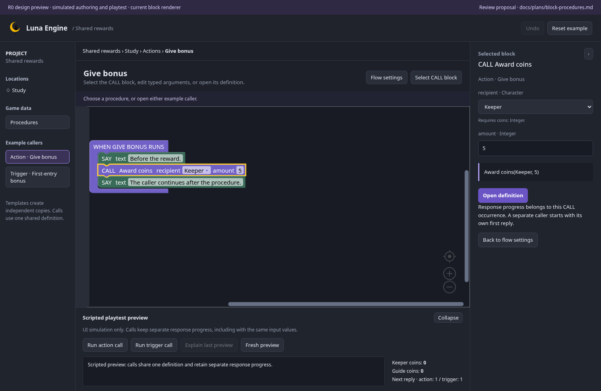

# Procedures — R0 design review

Status: **R0 accepted**, 26 October 2026, on `feature/block-procedures` from merged parser `main` at `d3c7860`. The owner accepted the authoring design and STOP/progress rules with “looks great”; no changes requested. The [R1 feasibility proof and contract](shared-contract.md) are complete (commit `0912607`); the [R2 foundation](foundation-review.md) is implemented, with dedicated production authoring next. This preview adds no production feature or file-format change.

Read the [implementation/design plan](../../plans/block-procedures.md). It covers typed local inputs, property contracts, caller navigation, shared-change repair, nested/event execution, stopping, response progress, versions, and the R0–R3 feedback/acceptance milestones. Conversations/quests follow the focused feature; extraction/refactoring remains later scope.

## Open the interactive preview

From the repository root:

```sh
npm --prefix web run dev -- --port 5182 --strictPort
```

Open [the procedures preview](http://127.0.0.1:5182/procedure-design.html). It is an isolated Vite entry, outside the production application build. It reuses the actual Luna Blockly renderer, existing effect blocks, inline fields, and flat terminal-chain rendering. Proposed CALL and input blocks are preview-only. Authoring history and scripted playtest state live in this browser tab; **Reset example** restores the initial example. No editor API or game/project file is used.

Quick views: [procedure list](captures/library.png), [definition](captures/definition.png), [CALL inspector](captures/caller.png), [input-change review](captures/impact.png), and [compact layout](captures/compact.png).



## Walk through the design

1. Open **Award coins**. Its block flow has a positive-amount condition, an update to the recipient's coins, speech using the amount input, and a response sequence. The inspector declares **recipient: Character, requires coins: Integer** and **amount: Integer**.
2. Open **Used by (2)**, then **Give bonus**. Inspect the CALL's typed values, open its definition, and use the separate **Return to Give bonus → CALL** control. The definition keeps its own Project → Procedures breadcrumb; the caller is a return context.
3. Rename **amount** to **reward**, then press Enter or leave the field. Return to either caller: values remain 5/2, while names update in fields/blocks. Names are labels; stable references are the proposed identity.
4. Change the Integer input to Text. Review definition uses and both callers. Cancel to preserve the current type, or apply as a draft to show repair findings and disable scripted runs. **Undo input type change** restores the complete earlier declaration and arguments.
5. Try **Add procedure**, add an input and a SAY block, then delete the unused definition. Deleting Award coins instead shows its two uses and requires reassignment/removal first. The preview demonstrates blocking used-definition deletion; production reference-management choices and full repair UI are R2 work.
6. Run the action/trigger examples in **Scripted playtest preview** and inspect the explanation. Each call site gets reply 1 independently. Set both callers to Keeper/5, start a fresh preview, and repeat: progress still belongs to the call sites, rather than the recipient/argument values.
7. Collapse the inspector/playtest and try compact layouts. All demonstrated authoring steps have labelled controls and keyboard routes alongside the real blocks.

The preview demonstrates the common literal-argument journey. Variable/property/forwarded arguments, complete body/argument repairs, input removal, copy/paste, production save/reopen, and real Rust call execution are specified in the plan and remain proof/implementation work. Block text edits/dragging are visual experiments; this prototype does not persist or execute those edited blocks. Scripted output follows only the supplied reward example and numeric arguments.

## Review decisions

| Topic               | Proposed first version                                                                                    |
| ------------------- | --------------------------------------------------------------------------------------------------------- |
| Placement           | Procedures under Game data, with the familiar block workspace and inspector                               |
| Inputs              | Explicit Object/Character/Location/Boolean/Integer/Text types, local to a call; entity property contracts |
| Navigation          | Open definition, precise return to CALL, and Used by                                                      |
| Shared edits        | Stable input IDs; review body/callers, preserve drafts/old values, provide atomic Undo                    |
| STOP                | Return from the current procedure; continue the caller; existing top-level STOP behaviour retained        |
| END GAME and errors | Propagate the ending; roll back the whole initiating transaction on error                                 |
| Response sequences  | Separate progress per stable caller/full nested call path; saved without replay                           |
| Later extension     | Automatic extraction from selected blocks, return values, external libraries                              |

The owner explicitly accepted these choices on 26 October 2026. R1 verified feasibility and froze the shared contract; any later implementation change to visible behaviour returns for design feedback. The existing block appearance is an already accepted requirement and remains unchanged.

## Verification

The standalone check covers creation, real block rendering, caller/definition breadcrumbs, rename, type-change cancellation/drafts/Undo, used/unused deletion, independent scripted cursors with identical arguments, modal Escape/focus restoration, and compact layouts. It rejects page errors, horizontal page overflow, and any project API request.

With the Vite preview running:

```sh
node web/design/procedures/verify.mjs
```

`LUNA_DESIGN_URL` changes the preview URL. `LUNA_FIREFOX_EXECUTABLE` selects an existing compatible Firefox executable when needed. `LUNA_DESIGN_CAPTURES` changes the screenshot directory; by default Chromium captures go to this directory's `captures/`. The script runs both browsers and is separate from production editor E2E tests.

Type-check only this isolated entry with:

```sh
web/node_modules/.bin/tsc -p web/design/procedures/tsconfig.json
```

Verified on 26 October 2026: both Chromium and Firefox pass the standalone workflow. It checks a visibly selected CALL on return, shared-input draft findings, rename/value preservation, cancellation/Undo, creation/deletion, independent cursors with identical arguments, native modal focus/Escape, panel toggles, and layouts at 1512, 900, and 520 px. No page errors, horizontal page overflow, or project API requests were observed. The five retained Chromium captures were inspected, including the compact counter layout.

The isolated TypeScript check, production frontend build, formatting, local documentation links, and whitespace checks pass. At R0, production application/Rust source, dependencies/contracts/format constants, examples, and historical fixtures had no changes. R1 subsequently added test-only coordination/regressions and shared root-flow/cursor helpers, recording its findings and gates in the [contract](shared-contract.md). The [R2 foundation](foundation-review.md) has since replaced that coordinator with canonical public-API regressions and real host storage/process checks. These R0 checks remain a preview usability/isolation record; dedicated production authoring and complete R2/R3 acceptance are still outstanding.

## References and implementation boundaries

- [Accepted editor UX](../editor-ux/README.md): current block bodies/inline fields, contextual settings, source return, history, and shared impact review.
- [Blockly procedures](https://docs.blockly.com/guides/create-custom-blocks/procedures/overview/): shared model-backed definitions/callers across JSON workspaces.
- [Custom procedure data models](https://docs.blockly.com/guides/create-custom-blocks/procedures/creating-custom-procedure-data-models/): custom typed models; documented default parameters use globals, while Luna proposes local bindings.
- [Node-RED subflows](https://nodered.org/docs/user-guide/editor/workspace/subflows): shared definitions, per-call properties, open-definition navigation, and cycle checks.

Checked against installed Blockly **12.5.1**, which exposes procedure-map/model interfaces. No plugin/version upgrade has been selected. Runtime canonical content remains Rust-owned. This visual prototype does not prove that a stock Blockly procedure plugin fits Luna's independent workspaces, typed targets, message references, and project history.
