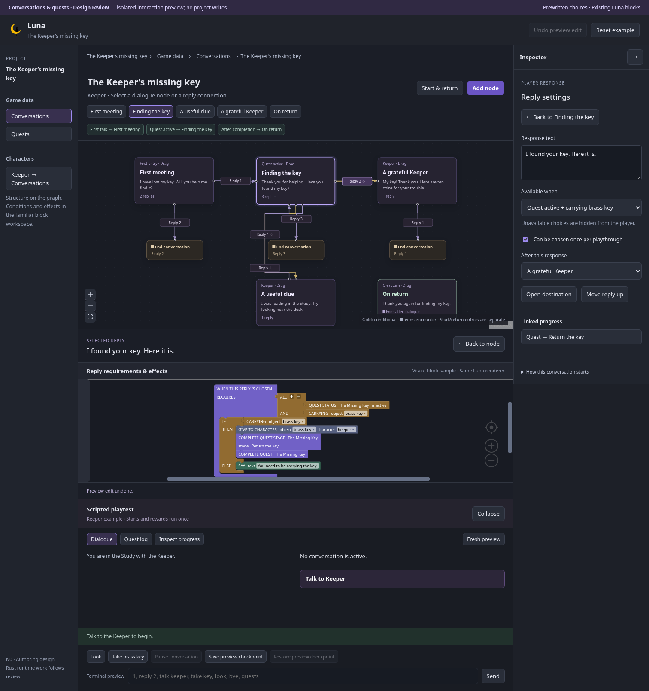

# Conversations and quests — N0 design review

Status: **N0 accepted; N1–N4 complete**, updated 27 October 2026, on `feature/conversations-and-quests`, from merged procedures baseline `040715d` (PR #4). The owner chose prewritten response choices and authorized the feature branch. The owner reviewed the first preview and requested clearer connections and distinct terminal/revisit dialogue. The owner accepted the revised design with “perfect that looks much better.” This is not runtime or file-format acceptance.

The [implementation plan](../../plans/conversations-and-quests.md) schedules the shared Rust proof and production implementation after this accepted design. The [frozen shared contract](interaction-contract.md) and [N1 Rust evidence](runtime-proof-review.md) guide implementation; the [N2 foundation record](foundation-review.md) now documents canonical models/persistence. The [N3 record](quest-runtime-review.md) covers implemented quest runtime/log and played persistence; the [N4 record](conversation-runtime-review.md) covers native conversation execution and played parity; production authoring is next in N5. The accepted N0 preview is committed as `4b613a9`. Existing Luna block appearance, inline fields, connection shapes, colours, and terminal-chain rendering remain required.

## Open the preview

From the repository root:

```sh
npm --prefix web run dev -- --port 5183 --strictPort
```

Open [the conversation design preview](http://127.0.0.1:5183/conversation-design.html). It is a separate Vite entry, excluded from the production application's build. It imports the existing Luna blocks/renderer, React Flow, modal/focus handling, styles and logo. No dependency or plugin was added.

All edits, Undo history and saved preview checkpoints stay in the current browser tab and disappear on reload. **Reset example** restores the complete initial design. The scripted playtest uses only the fixed Keeper example; it does not execute Blockly, arbitrary conditions, or a second JavaScript game interpreter. No project API, Rust runtime, canonical file, bundle, or real save is involved.

Quick views: [conversation library](captures/library.png), [graph](captures/graph.png), [reply inspector and real blocks](captures/reply.png), [quest stages](captures/quest.png), [conditional player choice](captures/player.png), [earned journal](captures/journal.png), and [compact panels](captures/compact.png), [start/return settings](captures/return-entries.png), and [the later visit](captures/revisit.png).



## Review the authoring journey

1. Open **The Keeper’s missing key** in **Game data → Conversations**. The same conversation is available through **Keeper → Conversations**. Each card represents a character dialogue node; a connection represents a numbered authored reply. Short connection labels refer to reply order; selecting one opens the full response text. Gold connections mark conditional choices. Each reply has distinct border endpoints; connections reuse Luna’s obstacle-aware routing and prefer clear inline labels. Small End conversation badges show terminal reply destinations. Dragging nodes changes only their layout, and selected connections open their exact reply.
2. Select **Finding the key**, then **I found your key. Here it is.** in its reply list. The inspector shows the response text, availability, once-per-playthrough setting and destination. Its real block sample shows the carrying/quest requirements, IF / ELSE, GIVE TO CHARACTER and proposed quest effects. **Back to node** and **Open destination** preserve a clear navigation route.
3. Edit response text and use **Undo preview edit**. Conditions control which choices appear, rather than offering a phrase/alias or fuzzy-matching form. These fixed condition presets illustrate the journey; production will expose ordinary condition blocks and synchronized inspectors.
4. Follow **Quest → Return the key**. Inspect its prerequisite, required flag, and journal text. **On completed · Reward** shows the existing CALL PROCEDURE block. Rewards belong to the once-only completion hook, not to every dialogue visit. Follow **Take brass key → Action** from the found stage to see how an ordinary action records progress; return without losing the selected stage.
5. Add a reply and choose a new node, an existing destination, or **End conversation**. Newly created nodes start as visible construction drafts. They remain authoring content until explicitly finished; they are never selectable player replies in this preview. Try **Add node**, **Add conversation**, **Add stage**, cancellation/Escape and Undo. Additional conversations and stages are visual authoring experiments, not new scripted scenarios.
6. Open **Start & return**. The completed-quest entry is **On return**, separate from **A grateful Keeper**, which speaks during the original handover. **Open return dialogue** shows “Thank you again for finding my key.” Its **After this dialogue → End conversation (terminal)** setting closes the encounter after that line. A reply can also end directly using its existing **After this response → End conversation** option. Pausing still resumes the existing checkpoint.
7. Use the node buttons and inspector controls with the keyboard as alternatives to graph/block dragging. Collapse the inspector/playtest and try a narrow viewport. This preview does not claim full graph or Blockly assistive-technology acceptance.

The main specimen deliberately stays small: one speaker, one quest and two prerequisite stages. Production still needs multiple character/quest selection, complete arbitrary condition/effect editing, general conditional-entry editing beyond the three Keeper presets, deletion/repair, find/usages, rich text controls, duplication, history persistence, and reference/template integration. Do not treat disabled/unrepresented production features as delivered by the preview.

## Review the player journey

1. Before talking, open **Quest log**. No quest or future milestone is disclosed.
2. In **Dialogue**, choose **Talk to Keeper**. Select one of the prewritten responses using its control, `1`, or `reply 1` in **Terminal preview**. Typing `yes` or dialogue text does not select a reply. The decline choice ends the exchange without starting a quest.
3. Accept the request. The quest becomes active and records its introduction once. **Where did you last see it?** leads to a clue and back. The return-key reply is absent while the player lacks the key.
4. **Look** preserves the encounter. **Pause conversation**, **Save preview checkpoint**, **Restore preview checkpoint**, and **Resume with Keeper** demonstrate an already-entered checkpoint without incrementing the entry/start counters. **Inspect progress** exposes the counters; **Try previous reply selection** demonstrates rejection of an old exchange's choice.
5. **Take brass key** is a successful world action: it pauses the encounter and records the found stage. Resume; the return-key choice is now visible. Selecting it hands over the key, records the return stage, completes the quest and gives ten coins once.
6. Read the completed **Quest log**, restore the checkpoint, end the exchange, and talk again. Historical entries and the reward do not replay. The next conversation uses the configured **On return** entry, speaks “Thank you again for finding my key,” and closes. The original reward promise and ten-coin effect do not repeat; later talks can repeat the short acknowledgement.
7. Change authoring text while the playtest is running. The current preview retains its original definition; **Fresh preview** applies the changed text/choice settings and clears that tab's checkpoint. Actual production setups and compatible story saves remain later implementation work.

The preview's generic prose/formatting, hard-coded world commands, in-memory checkpoint and fixed counters are interaction illustrations. They do not prove shared Rust execution, rollback, canonical/save compatibility, hidden-speaker behaviour, live stale-offer rejection, or the pending-clarification precedence policy. The separate N1 Rust proof tests those candidate boundaries before production implementation.

## Proposed responsibilities

| Surface                    | Responsibility                                                                       |
| -------------------------- | ------------------------------------------------------------------------------------ |
| Conversation graph         | Nodes, authored reply destinations, visible structure, layout                        |
| Node/reply inspector       | Dialogue/response text, order, repeat policy, contextual navigation                  |
| Existing Blockly workspace | Availability conditions, IF / ELSE and ordered effects; ordinary CALLs remain usable |
| Quest workspace            | Status hooks, prerequisite stages, required/optional progress, journal text          |
| Player dialogue            | Current NPC context and eligible prewritten choices only                             |
| Player quest log           | Earned historical journal entries; reading never advances progress                   |
| Author playtest inspection | Current checkpoint, stage/reward counters and source navigation                      |

Construction drafts are an editor proposal, not a new runtime `draft` flag. The prototype keeps them in its own temporary display model. The frozen contract defines explicit promotion and executable references before N2 writes the canonical schema. An executable reply targeting an unfinished draft must block a new production playtest/export with a useful finding, rather than silently dropping a destination.

## Interaction checks

With the Vite preview running:

```sh
web/node_modules/.bin/tsc -p web/design/conversations/tsconfig.json
node web/design/conversations/verify.mjs
```

The standalone check covers routed graph paths and labels clear of cards/each other before and after dragging, exact reply selection, editable start/return entries, terminal dialogue, repeated acknowledgement without another reward, text edits/Undo, conditions and real blocks, quest prerequisites/reward hook/source return, contextual creation/drafts, modal Escape/focus, numbered selection, rejected free text, hidden return choice, old-choice rejection, pause/resume, in-tab checkpoints, once-only rewards, immutable preview edits, keyboard routes and 1512/900/520 px layouts. It runs Chromium and Firefox and rejects page errors, horizontal page overflow and project API requests. It is separate from production editor/runner E2E coverage.

`LUNA_DESIGN_URL` changes the URL, `LUNA_DESIGN_CAPTURES` changes the screenshot directory, and `LUNA_FIREFOX_EXECUTABLE` can select an installed compatible Firefox executable. Chromium captures use this directory's `captures/` by default.

Verified on 26 October 2026: the complete standalone workflow passes in Chromium and the installed Firefox executable, including connection/label clearance, real graph dragging/layout retention, terminal/revisit behaviour and the 1512/900/520 px checks. The normal, ending, loop-back and conditional routes in this specimen are covered; dense arbitrary graphs remain a production layout/UX acceptance requirement. No page errors, horizontal page overflow or project API requests were observed. The isolated TypeScript check, production TypeScript/Vite build, all 89 frontend tests, formatting, local documentation targets and whitespace checks pass. The production build retains its existing large-chunk advisory. Production core/storage changes are outside N0; no tests are disabled or historical fixtures modified for this preview.

## Owner feedback and refinements

On 26 October 2026 the owner highlighted connection clarity and the misleading replay of “Here are ten coins” after the encounter had ended. The first preview did not expose the distinction between the reward exchange and a later entry well enough.

The revised preview provides explicit end destinations, a terminal dialogue setting, and editable Start & return choices. The reward exchange remains **A grateful Keeper**; the completed-quest entry is a separate **On return** terminal acknowledgement. General production entry conditions can also use visited-node/chosen-reply history or ordinary variables/properties, so revisit dialogue does not require a quest.

Graph badges are authoring decorations, not extra canonical runtime nodes. The N0 adapter reuses the existing map router and separates connection endpoints; labels prefer clear route segments, with faint leaders only for detached labels. Browser checks sample rendered paths/leaders and compare label/card bounds before and after dragging. This small specimen does not establish an automatic layout guarantee for every graph or replace later crossing/loop/dense-layout review.

The owner accepted these refinements and the N0 authoring/player design on 26 October 2026 with “perfect that looks much better.” Preserve the reviewed graph, prewritten choices, terminal/revisit distinction and existing blocks. Material visible changes return for feedback; N1 has since frozen the runtime/format target after the Rust proof; production authoring/runtime and final acceptance remain later gates.

## References and accepted design direction

- [Accepted Luna editor UX](../editor-ux/README.md): preserve existing block content/shapes, show contextual settings and clear source-return paths, and offer no-drag controls.
- [Twine's story map](https://twinery.org/reference/en/editing-stories/navigating.html): cards and arrows expose branching structure. Luna uses a character conversation graph and explicit reply settings, keeping effects in the existing blocks.
- [Yarn Spinner options](https://docs.yarnspinner.dev/write-yarn-scripts/scripting-fundamentals/options): offer written dialogue choices and branch after selection. Luna's response text is presentation; stable reply identities select executable content.
- [Yarn Spinner's options presenter](https://yarnspinner.dev/docs/godot/gdscript/04-showing-dialogue/03-options-presenter/): unavailable options can be hidden. Luna proposes hiding unavailable replies to avoid disclosing future puzzle topics.

External references checked on 26 October 2026. We reuse the existing installed React Flow/Blockly dependencies and Luna's visual language; these references do not require new libraries or a Yarn/Twine scripting format.

The graph plus selected-node/reply block arrangement, hidden unavailable choices, and preview interruption/checkpoint journey are the accepted N0 design direction. N1 must prove the runtime boundaries and report material changes for feedback. Prewritten choices remain agreed; fuzzy matching stays outside scope.
