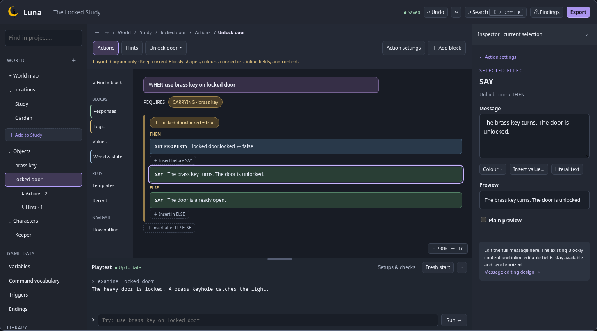

# Editor UX design review

Status: **Design direction accepted, with the existing block appearance and inline content preserved.** Detailed milestone reviews remain part of the plan.

Prepared 24 October 2026 against `main` at `92b3ab6`. Design work and subsequent approved UX changes belong on `feature/editor-ux`. Keep changes on that branch until the agreed scope has been tested and reviewed, then merge the complete change back to main together.

## Review the working checkpoint

Implementation has begun on the UX branch. Use the [first working checkpoint guide](first-checkpoint.md) for the actual editor, screenshots, undo/navigation walkthrough, technical evidence and remaining scope. Owner feedback on this working slice has been requested and is pending. The mockups below remain the reference for later milestones.

## Review the proposal

1. Open the [clickable wireframes](wireframes.html). Start with **World**, **Action**, and **Insert**; try selecting a block, returning to action settings, and collapsing the panels.
2. Read the [interaction design](interaction-design.md) for the behaviour behind each screen, including errors, keyboard operation, undo, and recovery.
3. Review the [implementation plan](../../plans/editor-ux.md) for dependencies, acceptance checks, and feedback checkpoints covering every Editor UX TODO.

The wireframes use sample content and simulated interactions. They do not run a game or save a project. They establish workflow and information hierarchy. Their rectangular block cards are schematic placeholders: production keeps the current Luna Blockly shapes, colours, connectors, inline fields, and content. They are not a proposal to restyle the blocks.

For a quick review without opening the HTML, use the [World preview](previews/world.png), [Action preview](previews/action.png), [insertion preview](previews/insert.png), and [compact-layout preview](previews/compact.png).

## Proposed direction

Retain the familiar hierarchy, central workspace, right inspector, and bottom playtest. Reduce competing navigation inside that layout: the hierarchy selects content, a compact workspace header selects its action or puzzle, and the inspector edits the current selection. Selecting a block shows that block's fields; a visible **Action settings**, **Trigger settings**, or **Puzzle settings** control returns to the containing flow.

Keep the current Blockly presentation for structure, branching, sequence order, and inline editing. Keep forms for names, settings, references, and formatted text. Both presentations edit the same content. Add clear insertion points and keyboard-accessible controls around the existing blocks so precise dragging is optional.

The owner accepted the surrounding layout and interaction direction on 24 October 2026, with an explicit requirement to preserve the existing block appearance and content. This includes the current jigsaw connections and flat final block in a chain. New inspector controls complement the existing inline controls; they do not remove, truncate, or replace them. Selection/finding cues may annotate the workspace without replacing the block bodies.

## Design decisions

| ID  | Decision                    | Proposed starting point                                                                                              | Status                                 |
| --- | --------------------------- | -------------------------------------------------------------------------------------------------------------------- | -------------------------------------- |
| D0  | Existing block UI           | Preserve current Blockly shapes, colours, connectors, inline fields/content, and terminal-block rendering.           | Explicit owner requirement             |
| D1  | Overall layout              | Refine the existing four regions; offer a larger playtest view without requiring a separate Build/Playtest mode.     | Design direction accepted              |
| D2  | Inspector selection         | Show one selected block's settings, with a persistent route to its flow and entity.                                  | Design direction accepted              |
| D3  | Navigation within an entity | Use an action/puzzle selector above the workspace; remove the additional permanent action-list column.               | Design direction accepted              |
| D4  | Undo model                  | One ordered project history, including grouped block edits; preserve native text undo while a field is being edited. | Accepted direction; technical proof M0 |
| D5  | Used references             | Default to replace/reassign or cancel before deleting referenced content; do not silently remove dependants.         | Accepted direction; detailed review M4 |
| D6  | Coordinated merge           | Keep the UX milestones on the feature branch and merge the completed, tested scope together.                         | Retained owner instruction             |
| D7  | Density                     | A comfortable desktop default, with explicit collapse/focus controls and a compact layout.                           | Accepted direction; width review M5    |

Accepted feedback should be recorded below and reflected in the wireframes and plan before implementation. Silence does not mark a design decision approved.

## Feedback log

| Date       | Screen / decision        | Feedback                                                                                              | Design change / status                                                                                                                   |
| ---------- | ------------------------ | ----------------------------------------------------------------------------------------------------- | ---------------------------------------------------------------------------------------------------------------------------------------- |
| 2026-10-24 | D1, D2                   | Initial layout and inspector questions sent to the project owner.                                     | Resolved by the feedback below.                                                                                                          |
| 2026-10-24 | D0; overall design       | Owner wants the blocks to keep their current appearance and content; everything else looks good.      | Preserve the existing renderer and inline fields. Record acceptance of the surrounding design and keep the planned feedback checkpoints. |
| 2026-10-24 | First working checkpoint | Compact selectors, selected-block inspection, navigation and initial unified history are implemented. | Working screenshot and feedback request sent; owner response pending.                                                                    |

## Design references

These sources inform Luna's proposals; the proposed Luna interactions are our adaptations rather than claims that another product implements Luna's workflow.

| Reference                                                                                                                                                            | Observed pattern                                                                                                                      | Application in this proposal                                                                                                                                  |
| -------------------------------------------------------------------------------------------------------------------------------------------------------------------- | ------------------------------------------------------------------------------------------------------------------------------------- | ------------------------------------------------------------------------------------------------------------------------------------------------------------- |
| [Node-RED nodes and quick-add](https://nodered.org/docs/user-guide/editor/workspace/nodes)                                                                           | Searchable quick-add can insert into a connection; nodes expose configuration errors and contextual properties.                       | A searchable block picker at a typed insertion point, selected-block editing, and visible findings.                                                           |
| [MakeCode simulator and debugging activity](https://makecode.microbit.org/courses/csintro/iteration/activity)                                                        | A nearby simulator gives feedback; debug mode highlights the code being executed.                                                     | Keep playtesting nearby; later explain a completed command and link it to its authored flow. Live stepping is a separate decision.                            |
| [Scratch Backpack](https://www.scratchfoundation.org/learn/learning-library/scratch-backpack)                                                                        | A reusable collection transports material between projects.                                                                           | Make project templates discoverable, then design explicit import/export with reference replacement. Copies remain independent.                                |
| [Blockly keyboard navigation](https://docs.blockly.com/guides/configure/keyboard-nav/) and [serialization](https://docs.blockly.com/guides/configure/serialization/) | Blockly documents keyboard operation and JSON workspace persistence. Current keyboard documentation includes APIs for newer versions. | Verify against Luna's installed **12.5.1** before choosing APIs or an upgrade. Preserve existing JSON workspaces and provide accessible application controls. |

Sources checked on 24 October 2026. Avoid assuming that a feature documented for current Blockly is available in the installed version.

## Current editor evidence

The existing editor already has separate game-data pages, an action/exit workspace, a central Triggers workspace, typed conditions, saved templates, collapsible panels, and a persistent playtest during navigation. Hints already have selection-driven inspector behaviour. Keep those capabilities and their existing game semantics.

Current areas to address include selection spread across component state, the extra action-list column, long action inspectors listing every text effect, entity-only search, and block selection that is retained for templates but not exposed as shared editor selection. Existing runtime trace strings are insufficient for the proposed detailed explanation view.

Code inspected: [application state and layout](../../../web/src/App.tsx), [actions](../../../web/src/Actions.tsx), [triggers](../../../web/src/Triggers.tsx), [block workspace](../../../web/src/Blocks.tsx), and [hint inspector](../../../web/src/HintInspector.tsx).
