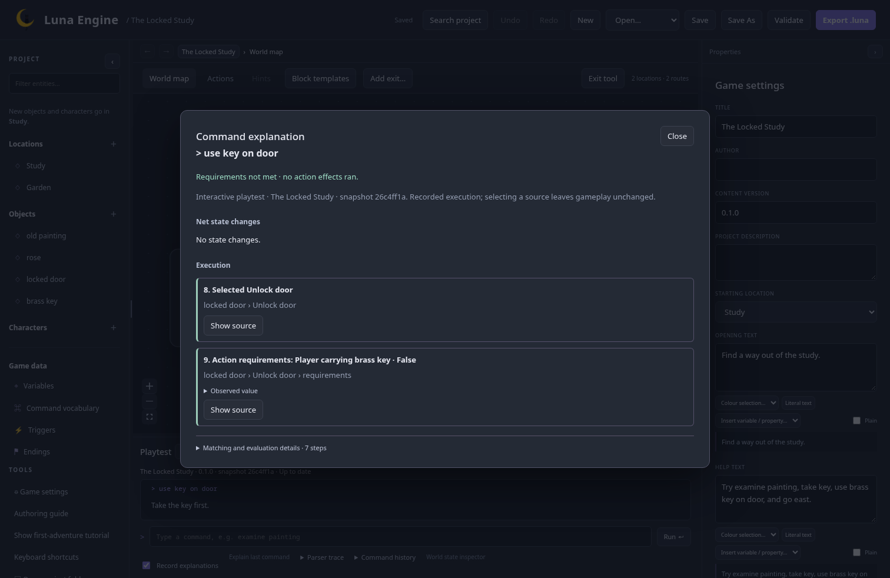
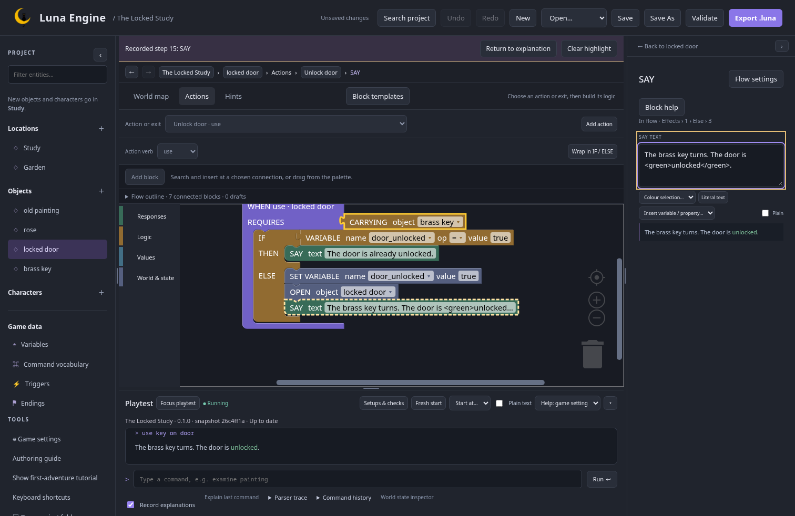
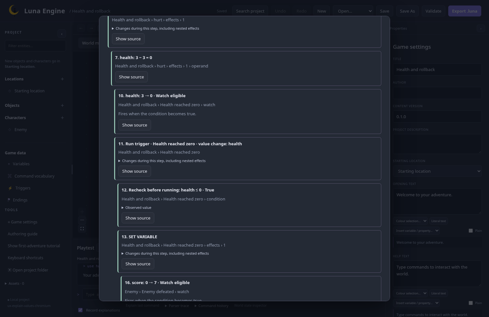
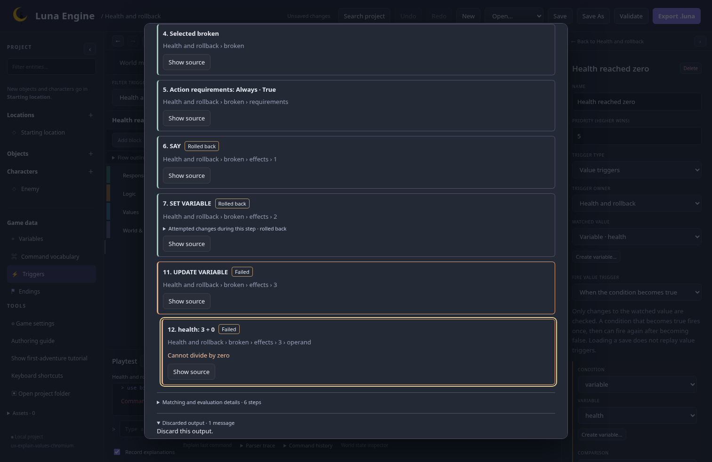
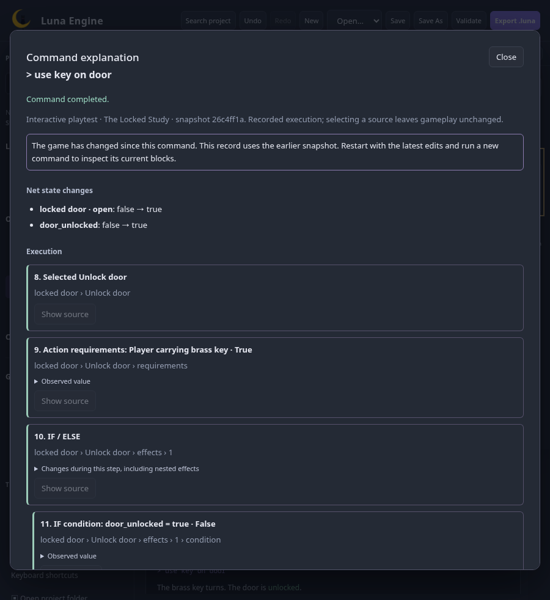

# Command explanations checkpoint

25 October 2026 · `feature/editor-ux` · M7 working review; owner feedback pending.

This follows the accepted [playtest setups and checks checkpoint](playtest-setups-and-checks.md). The [implementation plan](../../plans/editor-ux.md) governs the remaining milestones and coordinated merge. Existing Blockly shapes, colours, inline content, connections, and terminal blocks remain unchanged.

## Try the locked-door explanation

1. Create the built-in Locked Study template and start a playtest. **Record explanations** is enabled in the dock. Enter `use key on door` before taking the key.
2. Choose **Explain last command**. The record shows the selected action and the false carrying-key requirement. No action effects ran and there are no state changes.
3. Choose **Show source** on the requirement. The existing action workspace opens, selects the carrying condition, and adds a dashed outline. **Return to explanation** reopens the same record. Inspecting steps never replays the command or changes the game state.
4. Take the key and enter `use key on door` again. The explanation shows the true requirement, the false `door_unlocked` IF condition, the ELSE branch, effects in execution order, and the final property/variable changes.
5. Follow the SAY source into the existing block and inspector. Edit its message, then return to the record. It still describes the original snapshot, with a clear earlier-snapshot notice. Source buttons are disabled and the old outline is cleared. Restart with the latest edits and run another command to inspect the new content.
6. Expand **Matching and evaluation details** to see normalized input, candidate rejection or matching, ranking, and internal watch evaluations. Turn **Record explanations** off and run another command to return to ordinary unrecorded execution.

The author's edited example requires `adjust painting` before `take key`; the built-in template used above does not. The feature uses the same engine paths in both projects and does not modify either example.

## What a record means

Each record describes one completed command. It includes candidate selection, requirements and condition results, chosen branches, ordered effects, numeric operations with resolved operands, value-watch eligibility, and fired/skipped triggers. ALL and ANY conditions preserve short-circuit evaluation: children that were never checked do not appear. Matching is ranked by literal words, bound targets, owner scope, and authored priority; an equal top rank remains ambiguous.

The main timeline shows requirements, branches, effects, eligible watches, fired triggers, and numeric changes. Rejected candidates, skipped triggers, and internal before/after evaluations stay under Details by default. Step numbers retain their recorded order, so the main timeline may have gaps. This is a working default offered for feedback.

**Net state changes** shows the difference between the command's starting and final states. A step's expandable changes include its nested effects; these are inclusive snapshots, so they should not be added together. Names and placements are presented in terms of authored entities. Variables, properties, inventory ownership, visits, response/hint progress, and completion changes can all appear. Built-in controls have summary records; help/hint matching probes do not produce a full authored-effect timeline.

For a health-trigger example, set a player health variable to zero with an action. A value watch can then update score, which fires another watch to hide a defeated character or finish the game. The explanation nests the actual watch/trigger chain and shows resolved numeric values in order. Effects after an ending do not appear as executed.

For an arithmetic failure, an action can print a message, change score, and divide health by a variable whose value is zero. The record identifies the failed operand, labels earlier work as rolled back, and separates **Attempted net state changes** from committed state. **Discarded output** contains messages that the failed command generated; those messages never enter the playtest transcript. The command leaves the prior player state intact and the session can continue.

This is a record of a completed transaction. It adds no stepping, breakpoints, replay, or runtime editing controls.

## Source identity and inspection

The engine records canonical action/exit/trigger IDs and paths such as `requirements` or `effects.0.otherwise.2`. It has no dependency on Blockly IDs. The editor maps these paths to the current flow's existing block addresses, selects the block/field, and adds a removable dashed outline. Sources that describe whole-flow settings return to that flow.

Records retain the playtest's immutable project snapshot and the help override originally applied to that session. Source navigation is enabled only when the current game content matches that snapshot. Editor-only layout, navigation, preferences, and setup/check metadata do not invalidate it. Runtime edits disable source navigation while leaving the record readable; stale records never highlight an unrelated current block. Returning to a record and expanding details are read-only operations.

The recorder is optional in the Rust engine and enabled by the editor's request. Existing unrecorded command callers retain their normal result/error behavior. Recorded failures expose the error and discarded work without committing them. Records are runtime results, excluded from project metadata, game exports, and player-save formats. Editor and exported runner share the same command implementation.

To bound observation, a record retains at most 8,192 steps and 256 changes per state difference. Reaching these limits displays a truncation notice; gameplay and normal engine limits continue unchanged. Omitted details are not evidence that an effect did not run.

## Explain an isolated check

Open **Setups & checks**, run a saved or draft check, and choose **Explain command N** beside a recorded command. Checks request records independently of the interactive recording checkbox. Their explanations identify the check and command number, use the run's source snapshot, and include an engine failure if that stopped the check. A failed expectation still has a committed command record; an engine failure has a rolled-back record.

Viewing a check's explanation or source does not adopt its state into the interactive session. **Open result in playtest** remains the separate, explicit adoption action. Leaving an unsaved check draft to inspect its explanation requires the same discard choice as other navigation out of that draft.

## Presentation and feedback

The accepted Explain wireframe and MakeCode reference inform nearby execution feedback and source context. Luna uses its existing native dialog, readable event cards, and the original Blockly renderer. Candidate matching starts collapsed to keep the ordinary action explanation focused. Escape returns focus; compact layouts scroll within the window and keep source controls reachable.

Review how much detail belongs in the default timeline, whether the rollback wording makes attempted changes clear, and whether **Show source → Return to explanation** feels natural. The working presentation awaits owner feedback. Real zoom, screen-reader use, and a new-author walkthrough remain M9 manual acceptance checks.

## Verification and captures

All 59 frontend tests, Rust workspace tests, Rust formatting/Clippy, generated-contract checks, and frontend build/format checks pass. The full 76-check Chromium/Firefox suite passed, followed by four passing explanation walkthroughs after a final wording correction. The new walkthroughs cover failed key requirements, successful branches, exact source selection, stale-link prevention, compact layout, focus return, value-trigger chains, arithmetic rollback, recording opt-out, and failed isolated checks. Reading explanations and selecting source leave interactive state unchanged.

Core and editor API tests additionally compare recorded/unrecorded gameplay, exported runner transactions, named player-save restoration, short-circuit conditions, response follow-ups, and bounded recording without stopping commands. The release package and smoke check pass, including the embedded editor with source UI hidden. Final packaging will be checked again with the complete branch in M9.

M8–M9, final manual acceptance, and the coordinated merge remain open. The complete UX checklist stays open until that scope is accepted.
