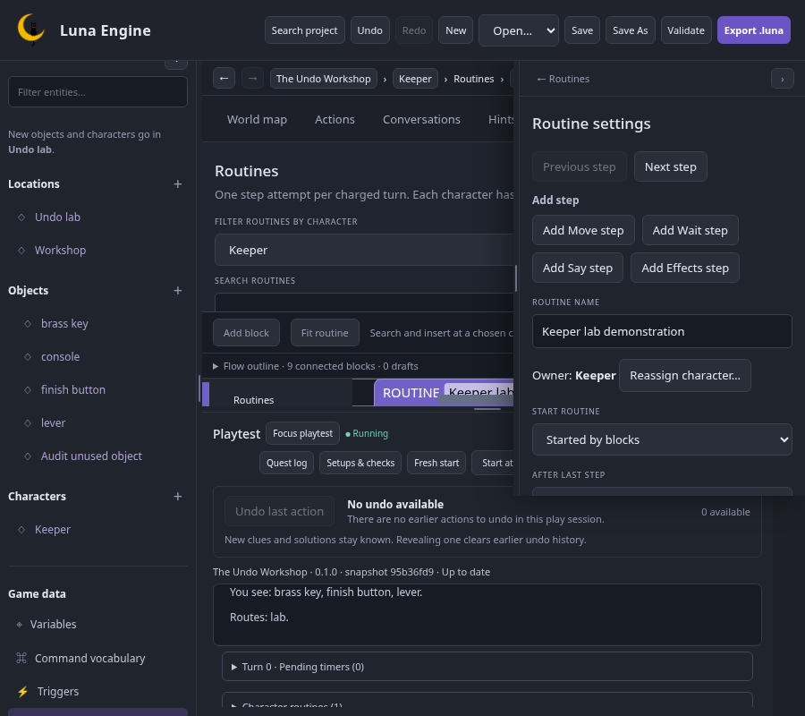

# Editor consistency and usability review

Reviewed **28 October 2026** against merged `main 8ea59d0` (player undo, PR #8). This records the baseline evaluation and proposed improvement order. The owner subsequently requested a cleanup branch; implementation and review status are recorded in the [cleanup review](cleanup-review.md). The current block appearance and inline editing remain an explicit owner requirement.

## Assessment

The editor has a sound shared editing model, but the surrounding workflows have become uneven as gameplay features were added. Selection, blocks, the inspector, project history, reference repair and nearby playtesting remain useful foundations. The largest problems are compact layout and context: panels can cover controls, usable block space can almost disappear, and some page names disagree with the selected content.

I recommend a focused consistency pass before freezing user-guide screenshots and step-by-step instructions. This can build on the accepted editor shell and existing blocks.

### Method and limits

The review combines source inspection, live Chromium walkthroughs of 26 screen states, 21 targeted observations in each of Chromium and Firefox, and four additional conversation-layout measurements. The retained [evidence](consistency-evidence.json) records measurements and control behaviour. Desktop review used 1512×982; compact review used 1100×800 and 900×800. Games were temporary copies of the examples; original projects were not edited.

The complete first-adventure authoring/save/reopen/export/runner journey and existing dialog-focus/primary-contrast checks were rerun in both browsers: **four passing regression cases**. No application exceptions were observed during the focused walkthroughs. Those passes do not establish consistent usability across every workspace: the layout defects below occur outside the paths those tests exercise.

This was an agent-led heuristic review. A first-time-author study, human screen-reader session, exhaustive contrast audit, and new actual-browser-zoom run were not performed. The existing human-evaluation follow-ups remain open.

## What is working well

- The block/inspector model transfers across actions, ordinary triggers, shared procedures, timers and routine steps. Inline editing and labelled inspector controls complement one another.
- Add block, compatible insertion previews and Flow outline provide useful alternatives to precision dragging. The completed two-room walkthrough still works without dragging.
- Project search preserves its query and returns focus on Escape. Used by and reference repair explain dependencies across live logic, setups and saved checks.
- Project Undo and player Undo have distinct controls and responsibilities. Restored player state retains the transcript; project edits keep their own history.
- Runtime edits have an explicit restart boundary. Named setups and isolated checks support repeatable testing without silently changing the running playtest.
- Native HTML dialogs generally have a consistent focus/cancellation foundation. The sampled primary-button contrast and dialog-focus regressions pass.

## Flow comparison

| Task | Current experience | Assessment |
| --- | --- | --- |
| Create a small game, play, save, reopen and export | The complete two-room task succeeds in both browsers. | Keep this as the baseline journey. |
| Edit an entity action or hint | A selector sits above the workspace; the inspector follows selection. Hints also offer Forms/Blocks. | Clear established pattern. |
| Edit a procedure, routine or timer | A persistent searchable library shares the centre with the block editor; at compact widths it becomes a 190-pixel top region. | Useful search, but its space cost needs a collapse/selection strategy. |
| Edit dialogue or a reply | Graph, dialogue/reply navigation, logic and inspector form a deeper composition. | The graph is appropriate; access to selected logic needs more deliberate layout. |
| Edit Variables, vocabulary or Endings | The form is in the right inspector while the centre and breadcrumb continue to say World map. | Context does not agree across regions. |
| Create values and reusable content | Some entries expand inline, some create immediately, and others open a dialog and produce a construction draft. | Different requirements are valid; success, focus, naming and status need a shared contract. |
| Delete and recover | Some unused content deletes immediately, other unused content asks a browser confirmation, and referenced content opens an impact review. | Recovery is available, but the policy is inconsistent. |

## Prioritised findings

High priority means a reproduced obstacle to ordinary interaction. Medium priority means repeated inconsistency or weak feedback. Low priority means supporting clarity and progressive disclosure. These are recommendations for the next scope review, not newly agreed release gates.

### UXR-01 — High: compact inspector covers playtest controls

**Reproduce:** open Undo Workshop at 900×800, leave the inspector expanded, select a routine and start playtest. The playtest collapse button is visible beneath the inspector's region but cannot receive a pointer click. Chromium and Firefox both report the inspector as the element at the button's centre. The same issue occurs at 900 and 1100 pixels during Keeper's Key dialogue with player undo disabled.

The inspector ends at viewport y=554. An undo-enabled dock starts at y=460, creating 94 pixels of overlap; the conversation-only dock starts at y=480, creating 74 pixels. The compact drawer offset follows the preferred 240-pixel dock height while these states enforce 340- and 320-pixel docks. See [compact offsets](../../../web/src/styles.css#L2016), [undo sizing](../../../web/src/styles.css#L2149) and [conversation sizing](../../../web/src/narrative.css#L237).

**Recommendation:** derive drawer/divider bounds from the actual dock region, including undo, dialogue, focus, resize and collapse states. Keep playtest controls clickable while editing. Collapsing the inspector first is a temporary workaround.

[Routine capture](previews/consistency-2026-10-28-compact-routine.png) · [Conversation-only capture](previews/consistency-2026-10-28-compact-conversation.png)

### UXR-02 — High: compact libraries leave almost no block workspace

At 900×800 with a routine selected and undo-enabled playtest open, the library takes 190 pixels, the flow surface has 105–106 pixels, and the actual Blockly SVG has **31–32 pixels**. Collapsing only the inspector does not recover vertical space. Collapsing playtest as well restores the Blockly region to 342 pixels in the measured case.

The shared [procedure/routine/timer library layout](../../../web/src/styles.css#L2651) has a fixed compact row budget. Conversation editing adds a graph above a detail region with a 470-pixel minimum, so selected logic requires another internal scroll even at the reviewed desktop size; see [narrative layout](../../../web/src/narrative.css#L160).

**Recommendation:** give each workspace a usable editing state. Use a collapsible library or compact selector, a clear Focus flow control, and a deliberate Graph/Logic presentation or resizable split for conversations. Preserve block text and shapes. Fit/zoom alone cannot recover a canvas this short while retaining readable editing.

### UXR-03 — Medium: page context disagrees across navigation regions

Select Game data → Variables, Command vocabulary or Endings. The correct form opens and the hierarchy marks it current, but the breadcrumb says **World map**, the World map button is active, and map/exit tools remain the central workspace controls. Procedures and Quests instead get their own named breadcrumb/workspace. This was observed directly; it is not the earlier Garden breadcrumb defect.

**Recommendation:** represent these global editors as explicit navigation contexts. The current page, breadcrumb, workspace title and inspector should agree. A full-width settings/data form may be more useful than leaving the map behind a narrow form; review that composition before choosing it. Keeping a map visible for context is also possible if the active editor is named accurately.

[Variables capture](previews/consistency-2026-10-28-variables.png) · [breadcrumb construction](../../../web/src/App.tsx#L1884) · [global forms](../../../web/src/Inspector.tsx#L64)

### UXR-04 — Medium: creation has no consistent success/focus contract

Add action expands an inline form; Add procedure immediately creates **New procedure**; Add routine opens a name/character dialog and creates an unfinished draft. Those content types need different defaults, but the author must learn where the next edit happens each time.

After Add action closes its form, focus is on `BODY` in both browsers; the next Tab reaches Action verb. Add procedure and successful routine creation instead leave focus on their Add buttons. New-item naming/status has no common focus or announcement pattern. Routine creation also always presents content-format compatibility text, even in an already compatible game.

**Recommendation:** share a creation contract: show owner/scope, select the created content, move focus to its meaningful first field or heading, and expose whether it is executable or a construction draft. Keep simple valid content quick to create; explain the Finish step consistently where required. Cancellation returns to the opener; successful creation should lead into editing. Show upgrade details when there is an actual compatibility decision.

Sources: [Actions](../../../web/src/Actions.tsx#L100), [Procedures](../../../web/src/Procedures.tsx#L55), [routine creation](../../../web/src/Routines.tsx#L83).

### UXR-05 — Medium: value creation validates differently by entry point

In Variables, enter an existing name such as `coins` and press Add. The input remains, the Add button stays enabled, and no explanation appears. In a block's Create variable dialog, the same name produces **This name already exists. Choose a different name.** Both browsers show this difference.

The Variables form also creates Boolean false first, then asks the author to change type/value. The contextual dialog offers type and initial value together. Entity properties reuse the inline form, so the difference affects two common authoring tasks.

**Recommendation:** use the same name/type/value validation and feedback in both presentations. State the scope clearly: game variable or property on a named entity. Keep an invalid name editable, show a local remedy, and make successful creation visible. Reuse the existing contextual validator rather than introducing another policy.

[Contextual validation capture](previews/consistency-2026-10-28-value-validation.png) · [inline value form](../../../web/src/Forms.tsx#L575) · [contextual validation](../../../web/src/ReferenceCreation.tsx#L151)

### UXR-06 — Medium: deletion and dialog policies vary by content type

Deleting an unused entity opens a browser confirmation with the generic message **Delete this unused content?** Removing an unused ending deletes immediately and exposes project Undo. Removing a referenced ending opens an in-editor impact review naming the ending and its dependencies. Save As uses a browser prompt while New project uses the editor's dialog/form system.

**Recommendation:** apply the accepted delete-unused-and-undo policy consistently. Keep named impact review for referenced content. Give recovery a specific label identifying what was deleted. Use the common dialog foundation for Save As and other multi-step input/review tasks, with validation in place. Use Delete for deleting content, Remove for detaching a reference, and Discard for abandoning a draft; this makes the wording predict consequences.

Sources: [entity deletion](../../../web/src/App.tsx#L842), [unused reference deletion](../../../web/src/App.tsx#L3193), [Save As](../../../web/src/App.tsx#L813), [accepted D5](README.md#design-decisions).

### UXR-07 — Medium: selected-state semantics are inconsistent

The main World map/Actions/Hints buttons show selection through CSS only. In both browsers the active Actions button has no `aria-current`, `aria-pressed` or `aria-selected`; its accessibility snapshot exposes three ordinary buttons. Trigger group switches already expose `aria-pressed`; retain that existing pattern. Hints Forms/Blocks also expose `aria-pressed`, and Setups/Checks implement a tablist with selected state and keyboard navigation.

**Recommendation:** choose and reuse the appropriate semantic pattern. Navigation controls should expose their current destination; view-toggle buttons can use pressed state. If a full tab pattern is chosen, implement its keyboard behaviour and panel relationship as well. Do not add tab roles alone. This is a verified programmatic-state gap, not a claim that a human screen-reader session was completed.

Sources: [workspace switches](../../../web/src/App.tsx#L2019), [existing hint toggle pattern](../../../web/src/Hints.tsx#L113), [existing tab pattern](../../../web/src/PlaytestTools.tsx#L260).

### UXR-08 — Medium: Back restores content but loses library search

Search Procedures for `Whole lab`, open the result, navigate to Routines, then use Navigate back. The procedure returns, but Search procedures is empty in both browsers. Project search, by comparison, preserves `lever` after closing and reopening it. The procedure filter is local component state and is not part of the saved navigation context.

**Recommendation:** restore each library's query/filter with its navigation entry and give empty search results a clear message plus Clear search. Keep global project search and local library search distinct, with consistent return behaviour. Extend this check to timers, routines and narrative libraries when implementing the shared pattern; the directly reproduced loss here is Procedures.

Sources: [procedure query state](../../../web/src/Procedures.tsx#L53), [saved navigation](../../../web/src/preferences.ts#L17), [persistent project search](../../../web/src/ProjectSearch.tsx#L5).

### UXR-09 — Medium: compact mode hides project save feedback

At 900 pixels, the header's save-status element is hidden by the 950-pixel media rule. The reviewed page can contain unsaved changes while offering Save and Export without showing the status that is visible on desktop. Error banners still exist; this finding concerns the missing ongoing saved/dirty feedback.

**Recommendation:** retain a compact visible saved/unsaved/saving indicator and its accessible status. Shorten it or move it rather than removing it. Keep project-save status distinct from playtest **Up to date / Edits need restart**: those describe different things.

Source: [compact header rules](../../../web/src/styles.css#L1417).

### UXR-10 — Low: discoverability and terminology lag feature breadth

The in-editor guide has topics for containers, procedures and routines, but no dedicated conversation, quest, turn/timer or player-undo topics. Selected block help mostly opens general block guidance. The palette puts Routines, Timers, Conversations & quests and Procedures above Responses/Logic in the reviewed feature-rich project. Assets offers upload/list controls without explaining how the bundled files relate to the current text-game experience.

There is also avoidable vocabulary switching: **Add node → Dialogue / Choose dialogue**, and **Scheduled → Add timer / Timer settings**. The underlying concepts are valid; labels should lead authors to the same concept in creation, editing, search, help and documentation.

**Recommendation:** agree a small UI terminology map before writing the guides. Prefer author-facing names such as Dialogue and Scheduled timers consistently. Review a fundamentals-first palette order and contextual help entry points with a new author. Explain Assets' current role beside its controls. These are good candidates to coordinate with the documentation work rather than building a second tutorial system.

Sources: [guide topics](../../../web/src/AuthoringHelp.tsx#L22), [palette order](../../../web/src/Blocks.tsx#L1585), [narrative controls](../../../web/src/Narrative.tsx#L213), [Assets](../../../web/src/App.tsx#L1779).

## A shared control grammar

The aim is predictable meaning and placement, while retaining suitable specialised views.

| Control or state | Proposed common meaning |
| --- | --- |
| Add… | Start creating content with clear scope; completion selects and focuses it. A disclosure can remain inline if that is the lighter useful form. |
| Create / Apply / Finish draft | Primary commit action, naming the result. Finish promotes editor construction into executable content. |
| Used by / Duplicate / Open definition | Secondary actions grouped consistently near the selected content's settings. |
| Delete / Remove / Discard | Delete content / detach a relationship / abandon a draft. Destructive styling follows the consequence. |
| Back / Close / Cancel | Navigate to a named parent / dismiss a view / abandon pending dialog edits. Preserve the invoking context. |
| Selected workspace or view | The same state is visible, programmatically exposed and reflected in the breadcrumb/title. |
| Saved / Draft / Edits need restart | Project persistence / executable readiness / running-session freshness, presented as separate states. |

## Suggested order before documentation

1. **Repair compact layout:** UXR-01/02, with UXR-09. Test inspector open/closed, normal/undo/conversation docks, resize/collapse/focus and the newer block libraries. Keep controls clickable and provide an intentional way to recover editing space.
2. **Agree shared navigation and interaction rules:** UXR-03/04/06/07/08. Prepare small mockups for the global data/settings workspace and compact library/graph layout before implementation; obtain owner feedback on actual flows. A separate `feature/editor-consistency` branch would follow the established coordinated UX workflow.
3. **Unify form feedback and copy:** UXR-05/10. Share validation and focus rules, settle labels, then build public guides and contextual links against that stable UI.
4. **Observe a new author and a screen-reader user:** retain the existing human-evaluation items. Record where people need coaching and re-prioritise from that evidence.

Future regression coverage should exercise clicks with the inspector expanded, selected-state exposure, creation/cancellation focus, duplicate-name feedback, Back with active filters, and compact save status. An in-viewport assertion or absence of horizontal body overflow alone does not catch a covered button or a 31-pixel editing region.

## Design references

The review uses consistency, system-status feedback, error prevention and recovery as evaluation criteria, following [Nielsen's usability heuristics](https://www.nngroup.com/articles/ten-usability-heuristics/). These are a review framework, not evidence that Luna's usability has been measured with people.

The accepted Luna design already drew on [Node-RED's node editing and quick-add patterns](https://nodered.org/docs/user-guide/editor/workspace/nodes): contextual properties, searchable insertion and visible configuration feedback. Keep those strengths while making the surrounding workspace predictable. The existing [Luna interaction design](interaction-design.md) remains the local design reference, including preservation of block appearance.

For tab semantics and keyboard behaviour, use the [W3C APG tabs pattern](https://www.w3.org/WAI/ARIA/apg/patterns/tabs/) where the UI actually uses tabs. Ordinary navigation and view buttons can keep native button behaviour with the appropriate current/pressed state. None of these references implies full accessibility conformance from this audit.
