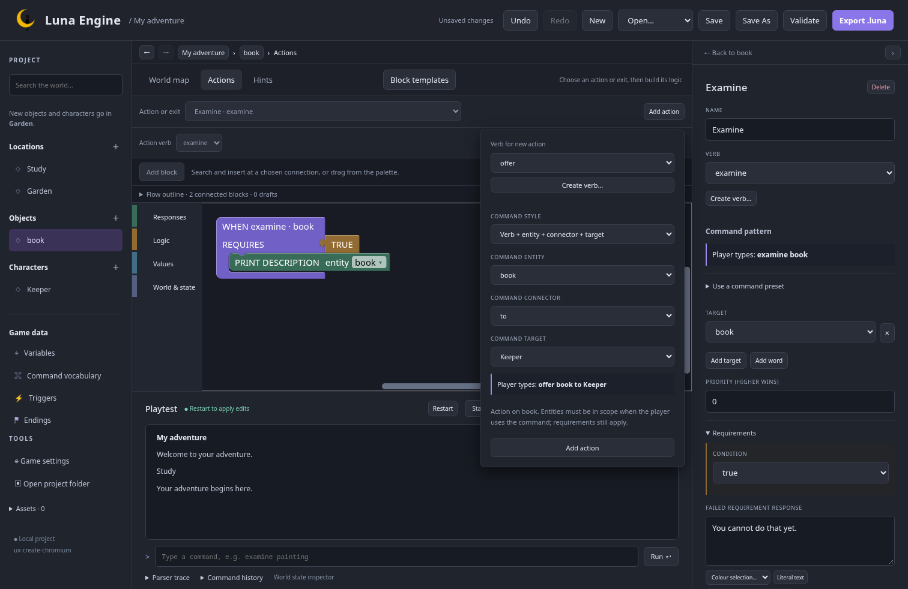
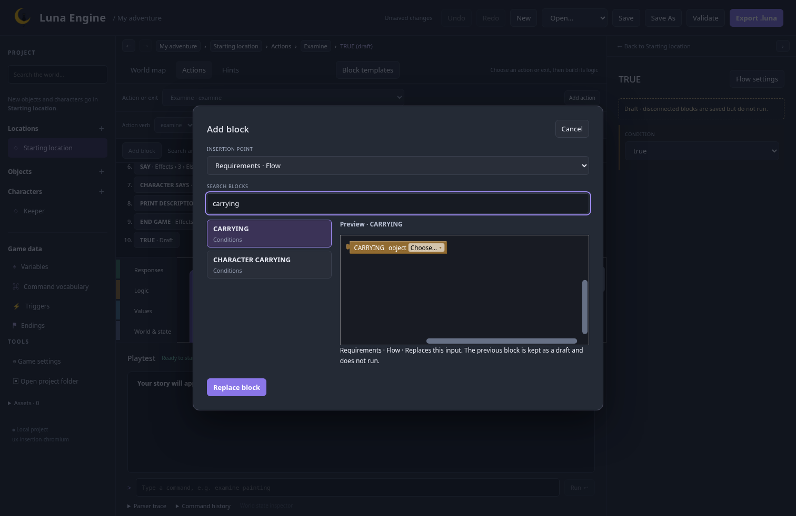

# Contextual authoring checkpoint

24 October 2026 · `feature/editor-ux` · working M3 review; not merged to main.

This follows the accepted [first checkpoint](first-checkpoint.md). It brings command creation and block insertion into the current workspace, using the existing Blockly renderer and inline fields. The [implementation plan](../../plans/editor-ux.md) still governs the remaining work and final acceptance.

## Try it

Build and launch from this branch using the [development instructions](../../development.md#build-locally). No installation is required.

1. Create a second location, then use **Add character** and **Add object**. Both use that location. Creating from another entity or its action uses its initial authored room; a character-held object's context follows its character's initial room. The hierarchy names the proposed room. A running playtest's location does not affect this choice.
2. Open **Actions → Add action**. Choose **Verb + entity + connector + target**, then choose `to`, `on`, `in`, or `with` and the target. The preview updates as you choose. Create a verb and its synonyms with **Create verb…** without leaving the form. Existing actions also have a **Use a command preset** section; applying a preset is explicit, and changing the verb preserves the pattern.
3. Use **Add block** above an action or trigger. Choose an insertion point, search using names or familiar terms such as `print`, and inspect the real block preview. **Enter** in the search field inserts the selected result; **Escape** cancels and returns focus. Ordinary buttons and native selects also work with the keyboard.
4. Insert CHARACTER SAYS between two effects. Both original blocks keep their identities, and the following chain stays connected. The insertion-point chooser and **Flow outline** also offer IF branches, response follow-ups, conditions and numeric inputs. Results are filtered by the connection type.
5. Replace an occupied condition or number input. The picker explains the replacement; the displaced block remains a saved draft. An inserted IF starts with an explicit TRUE condition. Drafts remain inspectable and do not run.
6. In the selected-block inspector, use **Create variable…**, **Create property…**, or **Create ending…**. Choose a type and initial value where applicable. Arithmetic references only offer integer creation. Creation selects the new reference and keeps the original block selected. One **Undo** removes the declaration and assignment together; **Redo** restores both. Duplicate names and reserved verbs are explained before creation. Cancel creates nothing.
7. Save, reopen, and playtest a target command, including a synonym of a newly created verb. Existing dragging, inline editing, templates, hints, undo and navigation remain available. Hints retain their existing Forms alternative; the new insertion catalogue targets action and trigger connections.

Compact picker captures: [1100 px](previews/implemented-picker-1100.png), [900 px](previews/implemented-picker-900.png).

## Review focus

Try building a short interaction using the labelled controls without dragging. Check whether the insertion-point names make it clear where a new block will go, and whether the command presets cover the common starting patterns. Record feedback before developing dependent authoring features.

The picker follows the approved quick-add reference: name the connection, search compatible blocks, preview, then confirm. The outline provides application-level keyboard controls on Blockly 12.5.1. This adds controls around the existing blocks and retains their shapes, colours, connectors, terminal rendering and editable content.

## Verification

All 46 frontend tests, the full 50-test Chromium/Firefox suite, and frontend build/format checks pass. Eight follow-up browser checks cover the final popup layering adjustment and the action/creation/insertion workflows. Coverage includes initial-room resolution, stable command references, middle/branch insertion, type compatibility, replaced input and shadow drafts, serialization, native dialog focus, cancellation, atomic reference undo/redo, authoring/reopen, target-command playback and desktop/compact layouts.

M4–M9, the full authoring acceptance walkthrough, release packaging and merging remain separate gates. The project TODO checklist stays open until the agreed complete UX scope is implemented and accepted.
