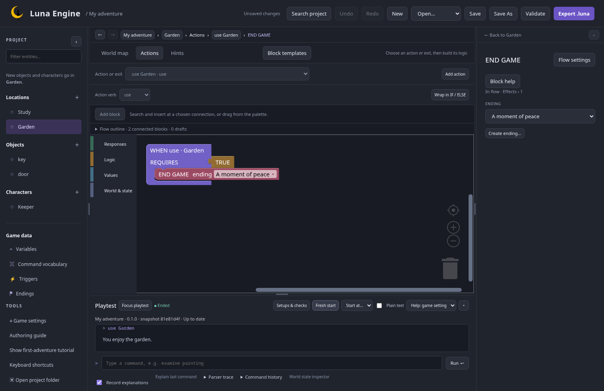
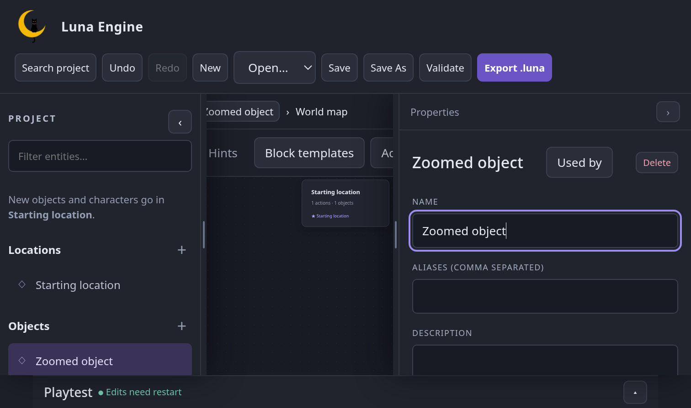
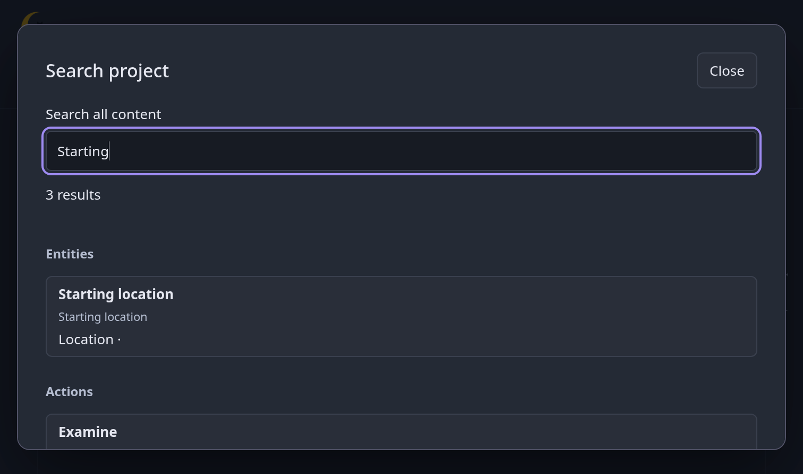

# Final UX review

Status: **M9 automated verification and agent review complete on `feature/editor-ux`; human review, final owner acceptance, and merge pending.** M0–M7 are the implemented scope. [Portable templates](../../plans/portable-templates-extension.md), originally M8 / UX-13, remain a deferred potential extension.

## Findings and fixes

- Primary buttons had white text with 3.60:1 contrast. The same purple family now gives 5.63:1 normally and 4.67:1 on hover. Stable-ID text now uses the existing muted text colour, giving 5.71:1 on the inspector background. Blockly colours and rendering are unchanged.
- The template library's manual keyboard loop included buttons inside collapsed recipe details. Templates now use Luna's native modal component, as do world-state inspection and external-change comparison. Background controls are inert, Escape closes the active dialog, and focus returns to its opener.
- Nested recipe cancellation initially bubbled to the containing template dialog during this audit. The shared modal now stops that cancellation from closing its parent; the keyboard regression checks both levels.
- Transcript scrolling explicitly requested animation even with reduced motion enabled. It now honours the browser preference, with a check that the latest reply is immediately visible when reduced motion is requested.
- The tracked `locked-study.luna` export lagged behind the editable example. It has been refreshed from a validated temporary copy of the current project. The authored source files and fixed historical walkthrough fixture remain intact.

## Authoring and compatibility evidence

The new acceptance walkthrough starts with a blank project and authors Study and Garden, a portable key, a door, puzzle hints, a locked-door recipe, a traversability condition, a Keeper speech action, and an ending. It uses forms, recipe previews, the Add exit dialog, and keyboard-activated block insertion without dragging. After saving and reopening, it plays blocked and successful paths, exports the game, and resumes a named runner save from the unlocked-door state. The existing pointer/drag walkthrough and the broader navigation, history, findings, references, hints, and playtest checks remain part of the suite.

The author's current Locked Study also validates, with its existing vocabulary-overlap warning for `take`. Separate temporary sessions reach the quiet ending and the ending after giving Tom his toy. Its fresh export plays in the runner and restores a named save before entering the garden. No example source files were changed by these checks.

Content format remains 1 and player-save format remains 2. Shared state types moved into the model without changing serialized player state. Optional setup/check metadata stays in editor files; personal layout/preferences stay in user configuration. Structured explanations are optional runtime results. Existing project, workspace, export, legacy-save, autosave, and named-save compatibility checks cover these boundaries.

Remote main was fetched for integration review and remains at `92b3ab6`, already an ancestor of this branch. There are no upstream changes to reconcile at this checkpoint. Fetch and recheck before the final merge if main advances.

## Verification record

| Check                                                         | Result                                                                                                                           |
| ------------------------------------------------------------- | -------------------------------------------------------------------------------------------------------------------------------- |
| Rust workspace tests, formatting, Clippy, generated contracts | Passed                                                                                                                           |
| Frontend unit tests                                           | 59 passed                                                                                                                        |
| Frontend build and formatting                                 | Passed on the final implementation                                                                                               |
| Chromium / Firefox regression suite                           | 81 passed; the Chromium-specific zoom test is intentionally skipped under Firefox                                                |
| Actual 200% browser zoom                                      | Chromium tab zoom set through its extension API, independently confirmed as 2.0; control reachability and modal scrolling passed |
| Final reduced-motion and zoom authoring follow-up             | 5 passed after the full suite; 1 intentional Firefox skip                                                                        |
| Release package and source-independent smoke check            | Passed with the refreshed example bundle                                                                                         |
| Owner's final walkthrough                                     | Pending                                                                                                                          |
| Human screen-reader and new-author review                     | Pending; automated role/focus checks are not evidence of a human assistive-technology session                                    |

The actual-zoom check uses an isolated browser profile and a temporary test extension. Firefox exercises the shared authoring, dialog, and compact-layout checks; the Chromium-specific extension test is intentionally skipped there. CSS viewport reduction and actual browser tab zoom are recorded separately.

The final follow-up verifies immediate transcript visibility with reduced motion in both browsers, and creates/edits an object at actual 200% Chromium zoom with the playtest collapsed. The final package was built after that change. This record distinguishes the earlier full suite from the final focused verification rather than implying that all checks were repeated after every edit.

## Captures from the tested editor

## Final owner walkthrough

1. Open the editor from this branch and use a new project or a copy of an existing game. Create two rooms, a key and door, a character reply, a hint, and an ending. The built-in authoring guide and locked-door recipe can help with the setup.
2. Follow both blocked and successful paths. Save/reopen, export, and continue the exported game in the runner. Compare the authored message, hint, ending, and inventory state.
3. Select a nested condition and message, leave and return using navigation, and check inline/inspector agreement. Insert and reorder blocks without dragging, then try project Undo/Redo. Preserve the current block shapes, colours, content, and flat chain ends.
4. Follow a finding into its block. Review Used by, a variable/property rename, and replace-before-delete. Check the affected-content preview and undo the change.
5. Tab through Block templates and Starter recipes. Open a recipe and press Escape: the library should stay open with focus on that recipe button. Press Escape again to return to the editor. Open World state and cancel it without applying changes; focus should return to its opener.
6. At 200% browser zoom, collapse panels as needed, reopen the inspector, edit an object, use search, and run a command. Check that controls remain reachable, dialogs scroll, text wraps, and the page does not require horizontal scrolling. Also try reduced motion if available in your system/browser settings.
7. Review labels, selected state, findings, and the transcript with a screen reader. If someone unfamiliar with the editor is available, have them try the first-adventure journey and record where they need guidance. These human checks have not been claimed as completed by automation.

Record feedback before marking the active UX checklist complete. The [M9 agreement](../../plans/editor-ux.md#m9--test-and-merge-the-agreed-scope) requires acceptance of the actual tested editor before the coordinated merge. If a manual check cannot be performed, agree and record any scope adjustment explicitly.
