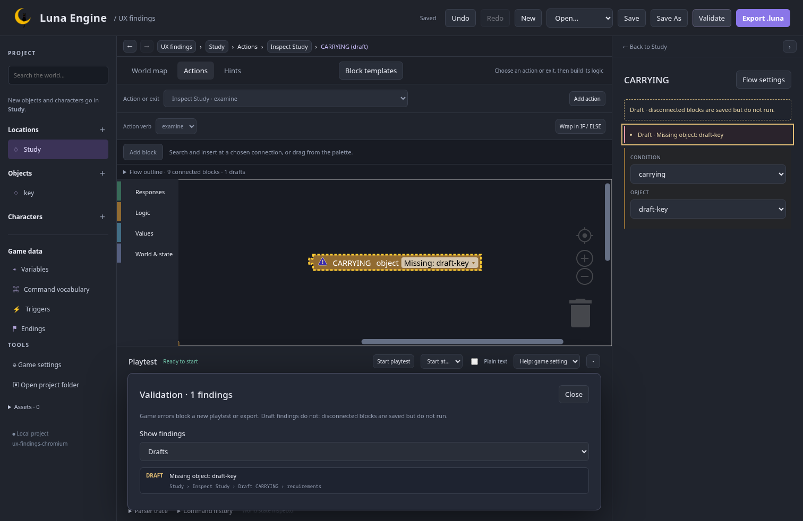
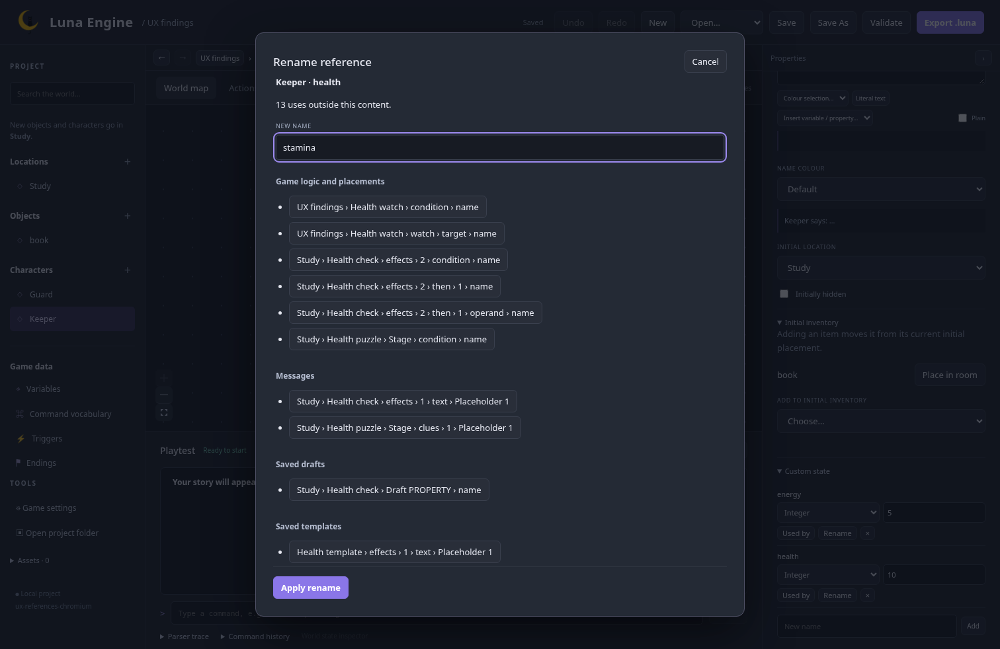
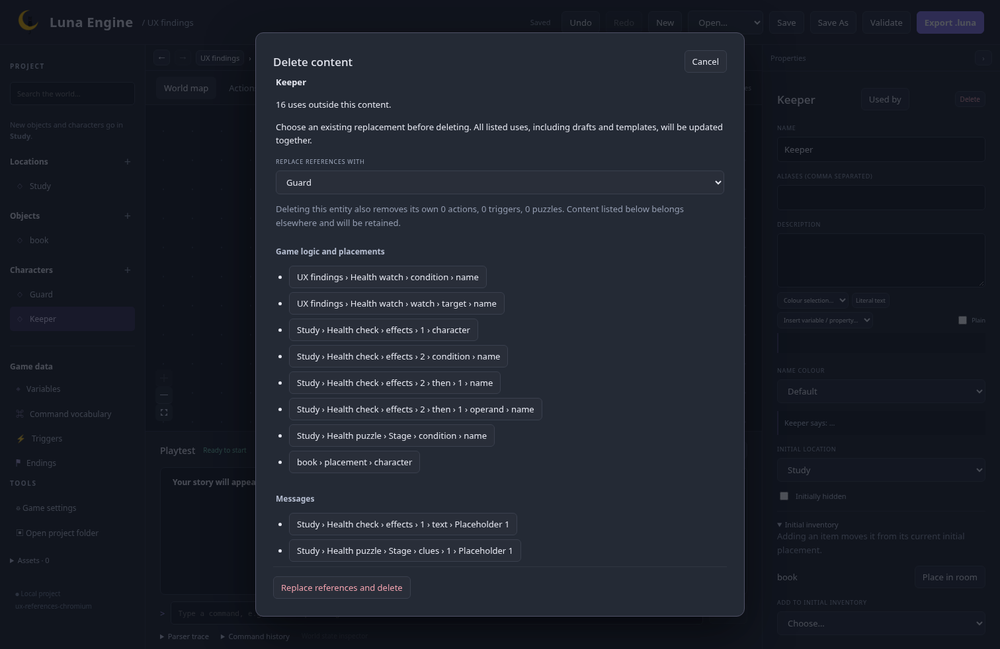

# Findings and references checkpoint

24 October 2026 · `feature/editor-ux` · M4 working review; detailed feedback pending.

This follows the accepted [contextual authoring checkpoint](contextual-authoring.md). It adds source navigation and reference management around the existing Blockly renderer, inline fields, and project undo. The [implementation plan](../../plans/editor-ux.md) governs the remaining milestones and coordinated merge.

## Try it

Build and launch using the [development instructions](../../../README.md#build-and-launch). No installation is required.

1. Open **Validate**. Filter game errors, warnings, or drafts. Select a finding to open its owner, action/trigger/puzzle, and affected block or field. Nested ALL/ANY/NOT and IF/ELSE conditions keep their own paths; a response error targets its individual reply, and a hint text error targets its clue or solution. The inspector opens when collapsed. Repair the value and the finding clears as the current revision is checked.
2. Disconnect an invalid block. Its dashed outline and draft notice explain that it is saved but does not run. Draft findings remain visible separately; they allow saving, exporting, and starting a playtest. Reopen to inspect or repair the same draft, including drafts in hint workspaces. Connected game errors block new playtests and exports. The Rust validator remains authoritative; older validation replies cannot restore findings from an earlier edit.
3. Open **Used by** on an entity, global variable, property, ending, verb, puzzle, or template. Links identify the owner, action/puzzle/stage, and occurrence. Game logic and placements, messages, saved drafts, and saved templates have separate groups. Live workspace mirrors do not duplicate game references in this list.
4. In **Custom state** or **Variables**, choose **Rename**. Preview every affected use before applying. The transformation updates conditions, watches, arithmetic, effect targets, message placeholders, saved blocks, and template bindings together. The original type and initial value remain. Duplicate keys, incompatible replacements, and names that would change a message's variable/property binding are explained before applying. Literal values and escaped `%%placeholders%%` remain literal.
5. Delete referenced content. Choose an existing compatible replacement explicitly, or cancel. The impact review names its own actions/triggers/puzzles/exits that will be removed and lists external content that will be retained and updated. A replacement entity must provide compatible properties where used. If a removed entity/flow owns a response sequence or puzzle used elsewhere, repair those links first. No replacement is chosen automatically.
6. Apply a rename or replacement/deletion, then **Undo** once. The declaration, all references, saved drafts, template bindings, and layout return together. **Redo** reapplies the complete change. Deleting a template leaves already inserted copies independent; its internal response resets do not depend on the original source flow.

Compact reference previews: [1100 px](previews/implemented-references-1100.png), [900 px](previews/implemented-references-900.png).

## Review focus

Check whether the grouped paths make an affected use easy to recognise, whether the draft/error distinction is clear, and whether the explicit replacement-before-delete flow feels appropriate. This implements the accepted D5 default. Record feedback on the working presentation before moving to dependent UX work.

The reference groups adapt the approved impact-preview design. Findings add icons, text, and draft border patterns to the current blocks while preserving their shapes, colours, connections, terminal rendering, and editable content.

## Verification

The Rust workspace tests, Clippy, formatting, generated-contract checks, all 53 frontend unit tests, build, and formatting checks pass. The full 56-check Chromium/Firefox suite passes; eight final findings/reference checks also pass after the last changes, covering compact preview controls, individual response/clue focus, hint draft repair, and stale validation replies. Existing hint/template authoring checks also pass. Reference tests include dotted IDs, global-variable precedence, escaped placeholders, data-only draft responses, owned sequence dependencies, template independence, and atomic history restoration.

No runtime or player-save format changes are required. Named playtest setups and portable template files remain M6/M8 work; their reference coverage must be added before those features enable transformations. M5–M9, the full authoring walkthrough, release packaging, and final owner acceptance remain open. Nothing has been merged to main.
