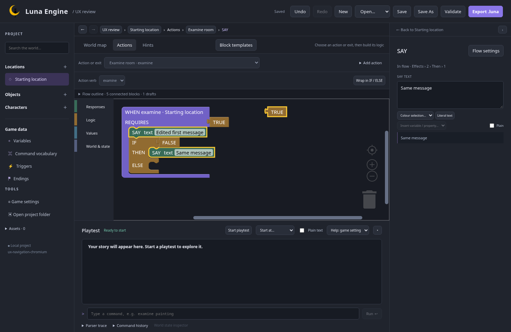

# First implementation checkpoint

24 October 2026 · `feature/editor-ux` · owner feedback applied; not merged to main.

This is the first working review of the approved design. It implements selection and navigation foundations plus the initial shared project history. The later milestones in the [implementation plan](../../plans/editor-ux.md) remain open.

The owner has accepted this checkpoint and the subsequent toolbar/breadcrumb corrections. The next working review is [Contextual authoring](contextual-authoring.md).

## Try the working editor

Build and launch from this branch using the [development instructions](../../../README.md#build-and-launch). No installation is required.

1. Select an object, character, or location and open **Actions**. Use **Choose action or exit** above the workspace. **Add action** opens the verb picker and closes after creating the action. Triggers and hints have equivalent workspace selectors.
2. Select a SAY, CHARACTER SAYS, response sequence, world effect, condition, or number block. The inspector follows that occurrence. Inline Blockly fields still work and show the existing content. **Flow settings** returns to action/trigger settings; **Back to …** returns to the entity.
3. Open **Flow outline** for labelled block-selection buttons, including detached drafts. Two identical messages are separate entries with different positions in the flow. Drafts remain editable and saveable but do not run.
4. Follow the breadcrumbs and use the navigation arrows. Return to the same block and its inspector field, with filters, scroll and canvas view retained. Collapsing the inspector or playtest does not end the running game.
5. Change a name or message, wrap effects in IF / ELSE, drag a room or exit label, and delete an entity. **Undo** and **Redo** reverse the project edits in order. Their tooltips and the workspace context menu describe the next operation. Saving keeps the timeline. Ctrl/Cmd Z in an active text field keeps native text undo; outside fields it uses project undo.
6. Start a playtest, then move a room or label. Layout changes keep the test current. Editing game content displays **Restart to apply edits**; the running session retains its original content.

Compact-width captures: [1100 px](previews/implemented-action-1100.png), [900 px](previews/implemented-action-900.png). These show the actual application, unlike the schematic wireframes.

## Technical decisions and evidence

- Keep Blockly 12.5.1. Use its selection events and editor-only block IDs, with canonical addresses derived from the current connections. Reconcile form changes without clearing unrelated drafts or replacing unchanged occurrences. The existing block renderer, shapes, colours, jigsaw connections, terminal rendering and inline controls remain intact.
- Use a labelled DOM outline for keyboard selection. The typed middle-insertion helper is proven independently; the searchable insertion UI remains M3 work.
- Use one bounded in-memory project timeline for forms, grouped Blockly events, templates and map edits. Workspace JSON preserves occurrence IDs and drafts during replay. Derived workspace serialization folds into the original form transaction. Navigation and player/debug state stay outside project undo.
- Retain at most 100 complete transactions or approximately 20 MiB of serialized snapshots, dropping the oldest first. Keep the newest complete transaction even if it alone exceeds that allowance. A synthetic project with 1,000 message effects occupied approximately 309 KiB per snapshot; 50 edits retained 33 transactions at the memory limit, taking about 90 ms in the local measurement. History is not written into project files or exports.
- Canvas views, recent selections, filters and inspector focus/scroll are currently retained for the open editor session. Persistent personal layout/configuration remains M5 work.
- Navigation, draft changes and map geometry are excluded from the running game's content revision. Validation replies are ignored when they belong to an older project revision.

The automated checkpoint covers frontend selection/reconciliation/history tests, authoring in Chromium and Firefox, compact widths, native text undo, mixed-operation undo across saves, existing runner/export/save parity, and the Rust workspace suite. See the implementation plan for the final recorded results.

## Feedback for this checkpoint

The owner approved the working direction and requested two corrections: style Add action and Add trigger like the hint button, and match the trigger dropdown's layout and spacing to its owner filter. Both are applied. Button styles and dropdown alignment were checked at 1512, 1100 and 900 px; six action/trigger authoring checks pass across Chromium and Firefox. Continue recording feedback before building dependent authoring workflows.

The searchable insertion UI, contextual creation, precise findings and reference management, persisted/resizable panels, onboarding/search, playtest setups/checks, structured command explanations, portable template files and final walkthrough/merge remain in the implementation plan. No completion of those milestones is implied by this checkpoint.
