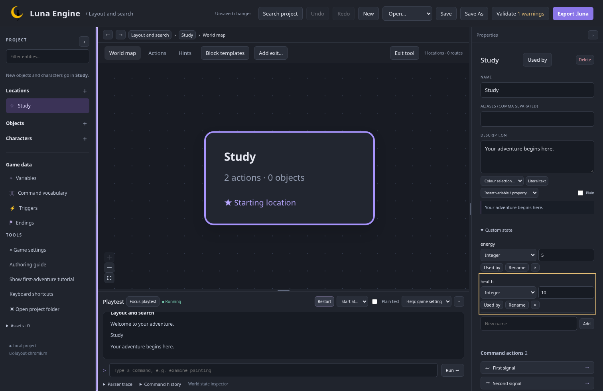
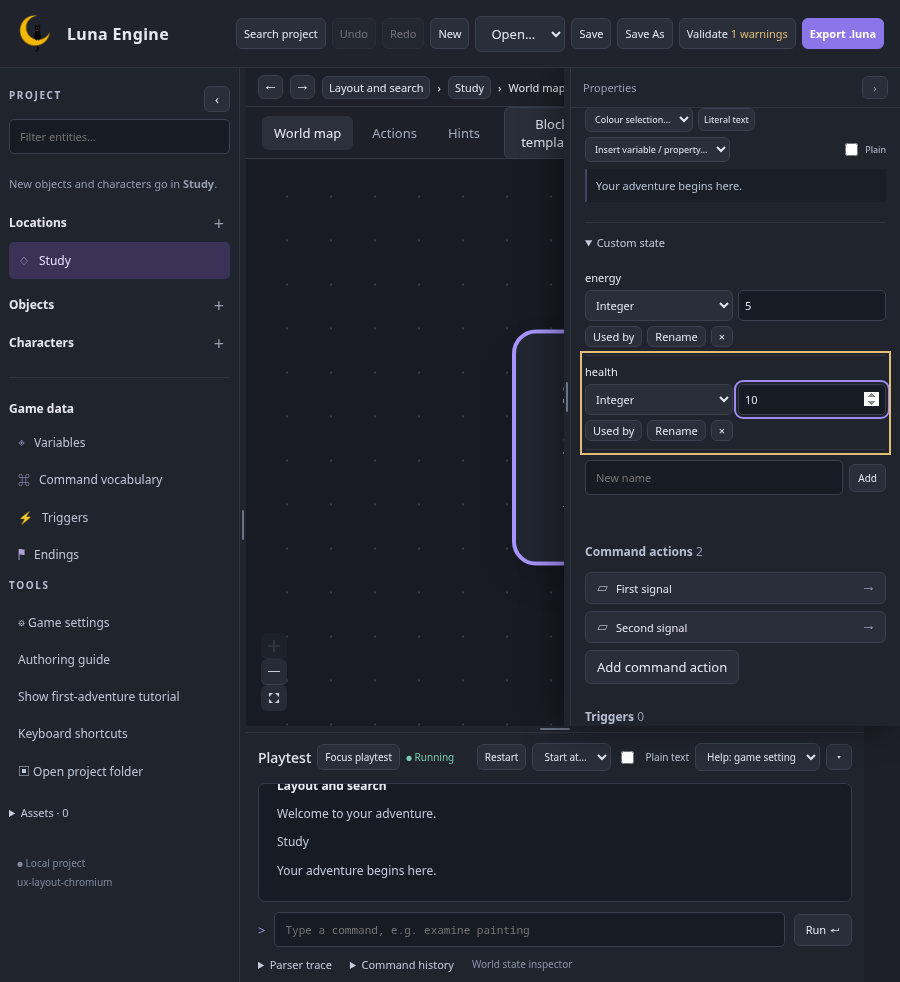
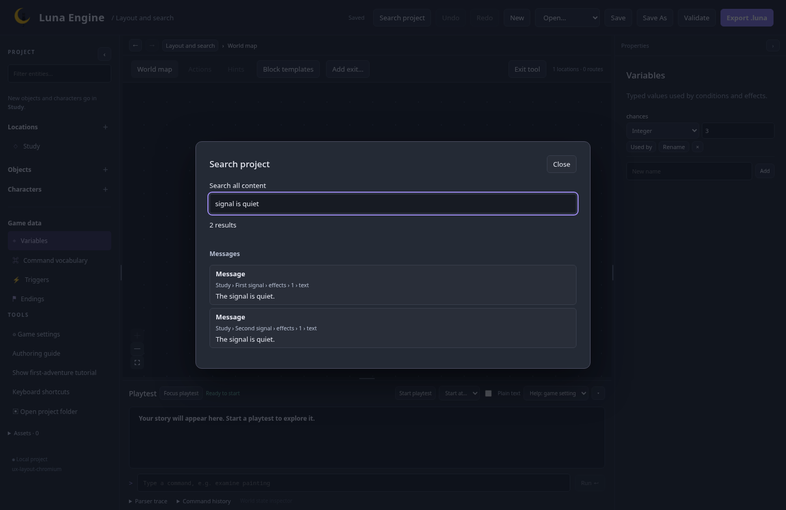
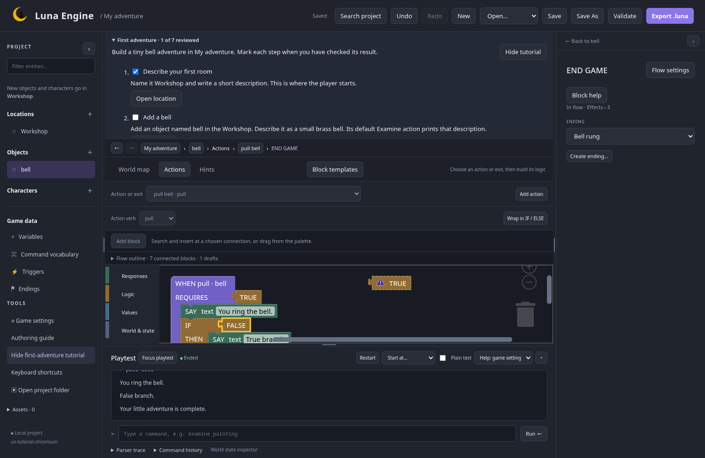
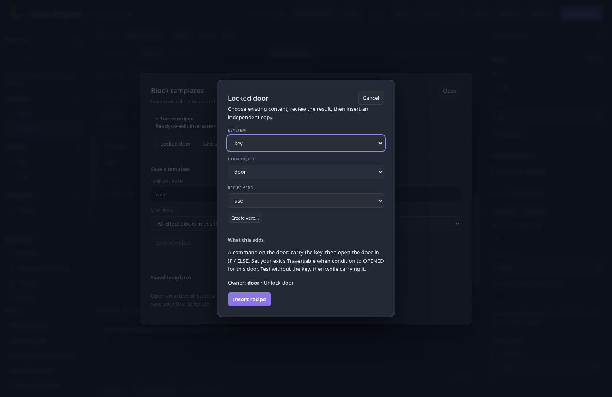

# Layout, search, and guidance checkpoint

25 October 2026 · `feature/editor-ux` · M5 working checkpoint accepted by the owner.

This follows [findings and references](findings-and-references.md). It uses the approved desktop/compact wireframes and keeps the existing Blockly renderer, connections, and inline content. The [implementation plan](../../plans/editor-ux.md) still governs the remaining work and coordinated merge.

## Try it

Build and launch using the [development instructions](../../../README.md#build-and-launch). No installation is required.

1. **Resize and remember.** Drag the dividers beside the hierarchy/inspector or above playtest. With a divider focused, arrow keys adjust by 10 px; Shift+arrow adjusts by 40 px; Home/End use its limits. Double-click resets that size. Starting preferences are 220 px for the hierarchy, 320 px for the inspector, and 240 px for playtest, bounded by available space. Each panel can collapse independently. At compact widths the inspector overlays the canvas as a drawer; at narrower widths the hierarchy does too. Drawers stop above the playtest dock so its controls stay accessible. **Focus playtest** temporarily folds both side panels and expands the transcript; **Return to editor** restores the authoring layout.
2. **Reopen your view.** Sizes, collapse state, selections, filters, canvas pan/zoom, expanded inspector sections, recent search text, and tutorial progress live in the editor's per-user configuration, keyed to the server-resolved project folder. They survive restarting on a new `--port 0` address and do not enter game bundles or player saves. Existing configurations receive defaults. Preferences save separately from project content and undo. Opening a different folder with the same game ID has independent preferences.
3. **Find an occurrence.** Open **Search project**, or use Ctrl/Cmd+K outside text fields/dialogs. Search names and words in messages across entities, actions, exits, triggers, puzzles/stages, variables/properties, endings, vocabulary, templates, and drafts. Results show context and a snippet. Identical messages in different actions remain separate. Select a result to reveal its exact field/block; **Navigate back** returns to the previous view. Reopen search to continue with the same query. Escape closes it and restores focus.
4. **Follow or skip guidance.** New project offers a blank start, The Locked Study example, or a first-adventure tutorial. Existing projects get no forced tour. Open **Authoring guide** or **Show first-adventure tutorial** from Tools at any time. The checklist links to the actual room, object, actions, endings, and validation. Check steps when you have verified their result; hide and resume it later. The short bell adventure tests both IF branches and ends with export. Bundled guidance works without the future documentation website.
5. **Start from a recipe.** Open **Block templates → Starter recipes**. Choose **Locked door**, **Give an item to a character**, or **Health ending**. Select existing references, review the owner and behaviour, then insert an independent copy. Verb/value/ending creation is available in context. A door recipe opens an object; explicitly set the exit's Traversable when condition to OPENED for that door. A health recipe watches an integer variable/property and ends the game when an update makes it zero or below. Begin with positive health and test both matching and nonmatching updates. Recipes never add hidden world dependencies.
6. **Author without dragging.** On World map, **Add exit…** provides source, target, and exit-name fields, including self-loops and return exits. Flow outline offers **Up**, **Down**, **Keep as draft**, and **Delete draft** controls. Reordering stays within the current branch and preserves nested content and following blocks. Each change participates in project undo. **Block help** explains effects, requirements, conditions, and messages; **Keyboard shortcuts** lists the controls actually provided.

Compact captures: [1100 px](previews/implemented-layout-1100.png), [900 px](previews/implemented-layout-900.png), and [756 × 491 CSS px](previews/implemented-layout-zoom.png), corresponding to the available CSS viewport of a 1512 × 982 window at 200% zoom.

## Review focus

The owner reviewed the working checkpoint and reports that it looks amazing and works well. The current layout and presentation are accepted. Tutorial clarity and recipe previews still benefit from a new-author walkthrough as part of final acceptance.

The application now has labelled keyboard splitters, native dialog focus/Escape handling for the new flows and project creation, visible focus outlines, reduced-motion styling, and button alternatives to precision dragging. Blockly 12.5.1 and the current renderer remain the baseline. Automated role/focus checks and a narrow CSS viewport are evidence for these interactions, not a claim of complete screen-reader support. Real 200% browser zoom, assistive-technology use, and the full owner/new-author walkthrough remain explicit manual acceptance checks.

## Verification

All 57 frontend tests, frontend build/format checks, Rust workspace tests, Rust formatting/Clippy, and generated-contract checks pass. The full 66-check Chromium/Firefox suite passes, followed by 16 passing checks on the final drawer/focus changes. Those final checks include measured drawer widths, actual compact field access, playtest controls with drawers open, focus/return restoration, profile restart, navigation/history, tutorial export/resume, and recipe gameplay. Coverage also includes root/folder isolation without project revision changes, a new port with fresh browser storage, duplicate message occurrences, field-level return navigation, independent recipe IDs, and branch-local reordering.

M6–M9, release packaging, final manual acceptance, and the coordinated merge remain open. The project TODO checklist stays open until the agreed complete UX scope is accepted.
