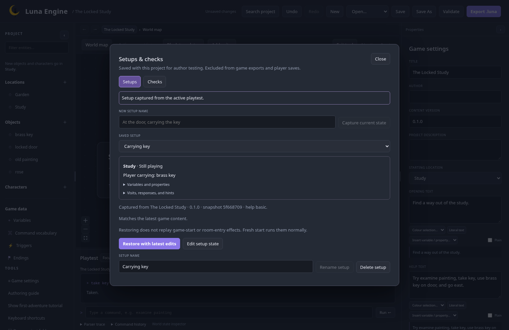
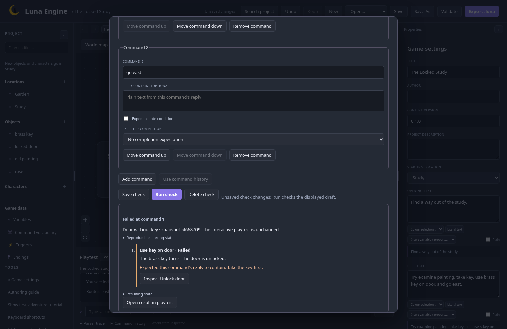
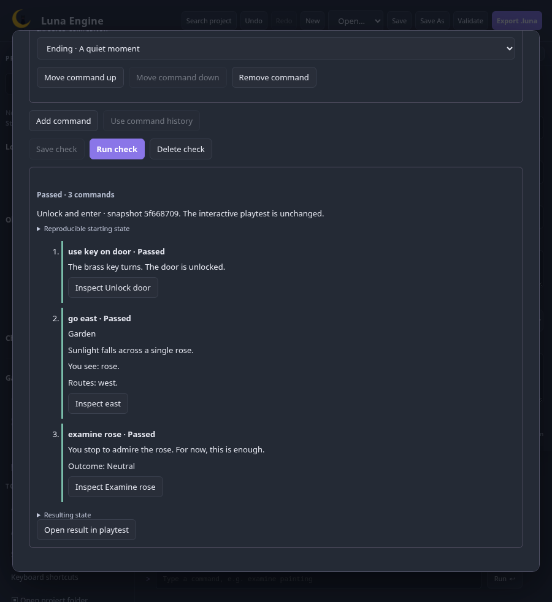
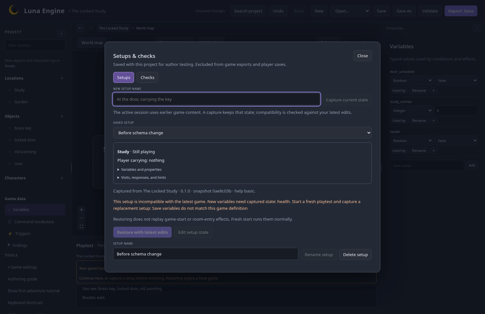

# Playtest setups and checks checkpoint

25 October 2026 · `feature/editor-ux` · M6 working review; owner feedback pending.

This follows the accepted [layout, search, and guidance checkpoint](layout-search-and-guidance.md). The existing Blockly appearance and content remain the reference. The [implementation plan](../../plans/editor-ux.md) governs the remaining milestones and the coordinated merge.

## Try the locked-door checks

1. Start a playtest of The Locked Study. Open **Setups & checks** in the playtest dock and capture **Without key**.
2. Close the window, take the key, and capture **Carrying key**. Each summary includes the current room, player and character inventories, variables/properties, visits, response positions, hint history, and completion state.
3. Choose **Restore with latest edits** to continue from a setup. It restores captured state without replaying game-start or room-entry effects. **Fresh start** runs the normal opening and events.
4. Open **Checks**, choose **New check**, and select **Without key** as its start. Enter `use key on door` and an expected reply containing `Take the key first.`. Save and run it.
5. Change the check to use **Carrying key**, retain that expected reply, and run again. The first command fails its expectation; following commands do not run. Review the actual reply and the resulting state.
6. Change the expected reply to `The door is unlocked.`. Add a variable condition checking `door_unlocked` is true, followed by `go east` and `examine rose`. Choose the expected ending on the last command. Save and rerun.
7. The interactive playtest remains unchanged during checks. Choose **Open result in playtest** when you want to continue from a run's result. The command history and transcript come with it.
8. Save/reopen the project and rerun a saved check. Setups and checks live in editor metadata and participate in project undo/redo; they do not enter game exports or ordinary player saves.

The author's edited example uses `adjust painting` before `take key`, and `go garden` as its named exit. The walkthrough above uses the editor's built-in Locked Study template. Both use the same restore and command execution paths.

## Runtime revisions and compatibility

The dock identifies the game's title, content version, and immutable source snapshot. **Up to date**, **Edits need restart**, and **Command running** distinguish its current status. Runtime edits keep the active session intact and display **Restart with latest edits**. This starts a fresh game; the banner offers capturing a setup before restarting. Map/block layout, navigation, personal preferences, and saved setup/check edits do not require restarting.

A setup records its capture source. Restoration and checks use the latest game logic, with an explicit compatibility check against the captured state. Changed messages can remain compatible. Added/removed entities or variables, changed property types, invalid response positions, missing hint stages, or a changed content version can make a setup incompatible. The UI explains the validation failure and disables restoration. Start fresh against the new definition and capture a replacement; state is never silently discarded or filled in.

**Edit setup state** uses the existing world-state fields and server validation. Saving it changes only that setup. Checked variable/property renames update the corresponding captured keys and check conditions together, preserving captured values and progress. Used by includes setups and check expectations. Deleting captured content requires removing affected setups first, rather than merging two captured entities or values. A setup used by a saved check cannot be deleted until that check's start is changed or the check is removed. Commands and expected reply strings remain authored literal text during reference transformations.

## Checks and source navigation

Each check starts fresh at the game's starting room, fresh at a selected room, or from a named setup. Its help mode can follow the game or use an explicit override. Command history can seed a check when its starting state is still reproducible. After manual state changes or editing/removing the setup used by that history, capture and restore a setup before recording new commands; the editor explains this rather than replaying history from a different state. The editor supports up to 100 commands, each with optional plain-text reply containment, a condition using the normal engine rules, and a completion expectation.

Checks execute in separate sessions and stop at the first failed expectation or engine error. Failed engine commands preserve their previous state through the ordinary transaction rollback. Runner save/load/quit controls are reported as unavailable in checks. Results retain the exact initial state, source snapshot, completed command history, actual replies, first failure, and final state. Repeated runs start independently.

**Inspect [action name]** reveals the selected action/exit while the run's game content matches the editor. If content has changed, the result asks for a rerun instead of pointing at an unrelated current flow. This uses a typed selected-flow identity; the richer branch/effect explanation remains M7 work.

## Presentation and review

The working presentation follows Luna's existing native dialogs for focused forms: one **Setups & checks** dock entry opens two tabs, leaving the transcript behind the window. Labelled controls, arrow-key tab selection, Escape/focus return, command reorder buttons, and a scrollable compact window support keyboard use. Fields stay fixed during a request. Unsaved check changes require an explicit discard choice when closing or switching checks; **Run check** clearly runs the displayed draft.

Review the restart wording, the setup summary, and how easily you can find the first failed command. The window presentation was offered for feedback; it remains a working review rather than an accepted final preference. Real browser zoom, assistive-technology use, and a new-author walkthrough remain manual M9 acceptance checks.

## Verification and captures

All 58 frontend tests, Rust workspace tests, formatting/Clippy, generated-contract checks, and the frontend build pass. The full 70-check Chromium/Firefox suite passed, followed by 18 passing targeted checks on the final history and snapshot comparison implementation. Browser coverage includes both key setups, state editing and restoration without replayed rewards, reply/state/ending expectations, first-failure stopping, explicit run adoption, source navigation, compact layout, save/reopen, restart isolation, incompatible schemas, keyboard tabs/focus return, and safe history reuse after manual state edits. Rust and frontend tests additionally verify character ownership, response/hint progress, repeatability, rollback, checked renames, runtime export exclusion, and runner named-save compatibility.

M7–M9, release packaging, final manual acceptance, and the coordinated merge remain open. The complete UX TODO checklist stays open until that scope is accepted.
