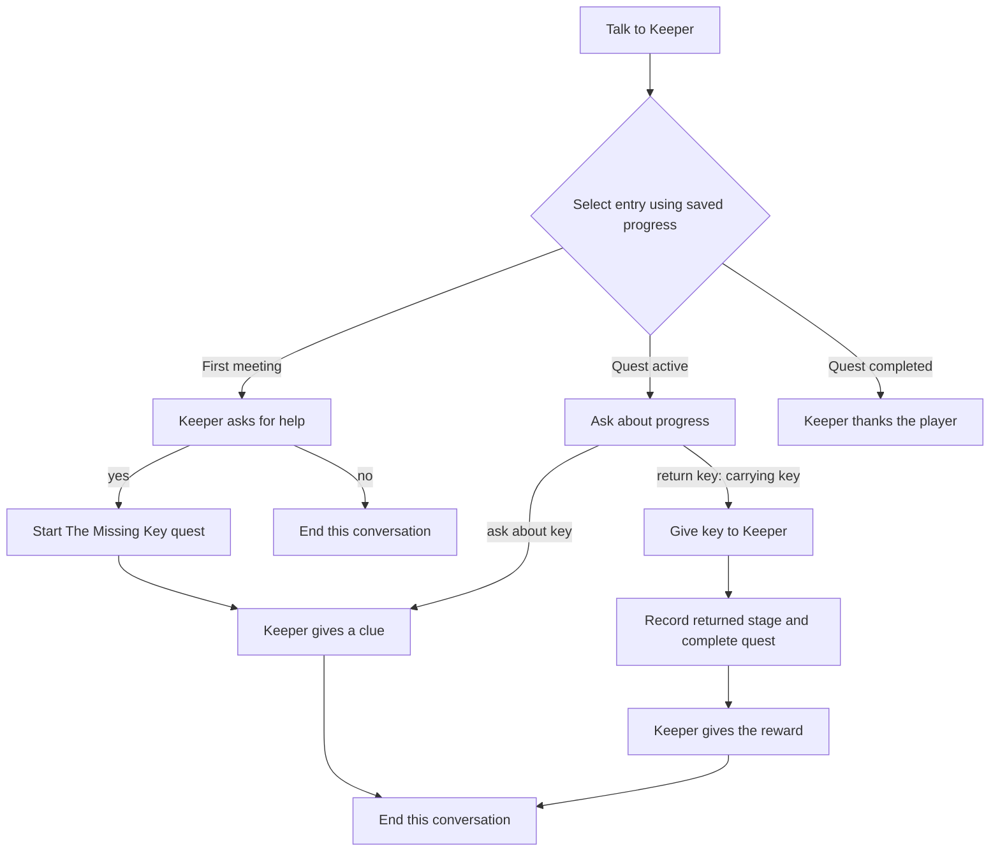

# Conversations and quests

Status: **Scheduled after focused procedures; detailed design review pending**, refreshed 26 October 2026. These features are not implemented. The owner agreed to basic procedures → conversations/quests → turns/routines. Editor UX, containers, and parser context are merged; public guides remain in the later documentation milestone. See the [current TODO list](todo.md) and [procedures plan](block-procedures.md).

Implementation branch: `feature/conversations-and-quests`, created from the current validated default branch when implementation begins. Keep the model, runtime, format changes, editor, runner, and acceptance example together on that branch until they work end to end. The planning document and todo entries can be reviewed before that work starts.

## Updated foundations and review boundary

The merged baseline is parser context at `d3c7860`: content formats 1–3 and save formats 1–3, container/private inventory scope, rich messages, and session-local clarification/recent references are implemented. Focused procedures are being designed on their own branch. Reconfirm versions and use the merged procedure contract when this branch begins; no narrative format number is reserved.

Conversations and quest hooks should use ordinary effects, including shared CALL where useful. Forward typed inputs explicitly, reuse the agreed STOP/ending/rollback rules, and give each node/reply/hook a stable progress root for nested procedure response paths. Plain effect blocks remain sufficient for authors who do not use procedures. Narrative state must not introduce a second parameter evaluator or shared-call cursor scheme.

The following parser/conversation boundary needs prototype review before freezing the runtime contract:

- F2 clarification is ephemeral Session context; conversation checkpoints/history are saved story progress. Load clears the former and restores the latter without replaying effects.
- Explicit conversation replies, short eligible phrases, world commands, and numbered choices need one deterministic priority table. A number must belong to its last offered context and stable identities. Refresh stale lists before accepting a choice; never let a parser number select a conversation reply accidentally.
- A world command can itself need noun clarification during an encounter. Specify which prompt owns subsequent replies, whether the encounter remains active until the world action succeeds, and how cancellation returns to it. Questions/retries/failed requirements must not silently pause or advance a conversation.
- Preserve assisted `cancel` semantics when clarification is enabled and authored `cancel` when disabled. Review explicit `reply ...`, conversation pause/bye, and reserved-prefix collision upgrades together; do not silently commandeer existing commands.
- Conversation phrase selection is confined to the active node; it cannot use F2 fragment matching to discover future topics. Conversation replies do not invent a recent-object referent. Ordinary authored world commands retain the F2 reference policy; help/hints retain existing scoped ID resolution.

These are integration requirements and open interaction decisions, not an implemented conversation precedence policy. The detailed conversation wireframes will be reviewed after focused procedures merge.

## Goals and scope

Give characters conversations with context, branching replies, and consequences. A player can answer `yes`, `no`, or `ask about the key` when those replies belong to the current exchange. Knowing a phrase from a later exchange must not make that exchange accessible.

Give players a quest log recording discovered goals and completed milestones. Conversations, ordinary actions, and triggers can all update quests. Hints can use quest progress to choose useful clues.

Both features belong to the shared Rust runtime, so editor playtests and exported terminal games behave alike. Reuse Luna's conditions, effects, message formatting, stable references, transactional commands, and persistence.

Proposed first-release defaults:

- Typed replies, with an author option to display available reply labels or numbered choices. This presentation choice is still open to user feedback.
- One active conversation at a time, with saved checkpoints and persistent reply history.
- Explicit quest progression through effect blocks. Quest conditions support actions, conversation replies, triggers, and hints; merely reading the log never advances a quest.
- Ordinary single-player text adventures. Natural-language AI, arbitrary scripts, timed replies, repeatable quests, and multiplayer conversations are later work.

## A complete authoring example

The Keeper has lost a key. The player can accept the request, find the key, and return it. Asking for the reward at the first greeting cannot select the later reward exchange.



An ordinary take action records the "Found the key" milestone. The handover reply checks both carrying the key and the quest's progress. It transfers the key, records the return milestone, completes the quest, and gives the reward in one transaction. Repeating the reply cannot award the reward again.

The player log might show:

```text
The Missing Key — Active
  The Keeper asked me to find a lost key.
  I found the key in the Study.

The Missing Key — Completed
  The Keeper asked me to find a lost key.
  I found the key in the Study.
  I returned the key to the Keeper.
```

Future milestones, their conditions, and the reward are absent from the player's log until revealed by the story.

## Conversation definitions

Use a directed graph with stable node and reply IDs. Branches can merge, and intentional loops can return to earlier topics.

| Definition   | Proposed contents                                                                                                                       |
| ------------ | --------------------------------------------------------------------------------------------------------------------------------------- |
| Conversation | ID, authoring name, character reference, start condition, ordered conditional entry points, default entry node, reply presentation mode |
| Node         | ID, authoring name, character's formatted dialogue, entry effect blocks, ordered replies                                                |
| Reply        | ID, player-facing label, accepted phrases/aliases, availability condition, repeat policy, effect blocks, destination node or end        |
| Entry point  | Condition and destination node; first matching entry wins, otherwise use the default                                                    |

Dialogue lines support the existing colours and variable/property placeholders. Reuse CHARACTER SAYS's `text::speech` formatter, including the character's current name and configured name colour.

Add condition blocks for whether a node has been visited or a reply has been chosen. Existing variables/properties and new quest conditions can model learned information. A hidden reply still needs a progress condition if guessing its words should be insufficient to unlock it.

The ordinary action `talk Keeper` contains START CONVERSATION referencing the conversation. This preserves the existing command vocabulary, aliases, owner scope, and requirements. The editor can offer to create that starter action when the first conversation is added, while preserving existing talk actions. Multiple conversations can belong to one character and be started by different authored actions or conditions.

### Reply matching and progression

1. Resolve replies only among the active node's replies. Recheck their conditions and repeat policy against current state.
2. Initially use normalized, complete phrases and explicit aliases. For example, `yes`, `y`, and `certainly` can name one reply; `key` and `ask about the key` can name another. Do not use unrestricted substring matching, so `yesterday` cannot accidentally mean `yes`.
3. A future node, a failed condition, or an already-used once-only reply supplies no eligible match. Unknown or blocked replies do not alter state, consume a reply, or reveal locked topics.
4. Multiple eligible matches request clarification and apply no effects. Warn about overlapping aliases during validation; reject obvious unconditional duplicates.
5. Mark a once-only reply as chosen before its effect blocks run, then follow its authored transition. Nodes and replies can give items, change values, reveal locations, advance quests, or end the game using ordinary effects.
6. Enter the destination node, run its entry effects once for that entry, then print its formatted line and derive the current replies. Re-entering through an intentional graph loop is a new entry; resuming or loading a checkpoint is not.

Entries, reply effects, transitions, messages, quest updates, and resulting triggers share the original command transaction. A runtime error restores the previous node, reply history, world state, quest log, and output. Count all nested work against the existing operation/depth limits.

A terminal destination closes the conversation. A nonterminal node with no eligible replies also closes cleanly after its line, with an authoring/playtest diagnostic where appropriate, rather than trapping the player. Automatic routing chains are outside the initial scope; graph loops require a player reply.

### Commands and interruption

| Input                                                                            | Proposed behaviour                                                                                                                     |
| -------------------------------------------------------------------------------- | -------------------------------------------------------------------------------------------------------------------------------------- |
| `talk Keeper`                                                                    | Run the ordinary authored action; its START CONVERSATION effect starts or resumes the referenced conversation                          |
| `reply yes`                                                                      | Always route to the active node; never fall through to ordinary world actions                                                          |
| `yes` / `no` / another matching short phrase                                     | Prefer an eligible reply in the active conversation; retain ordinary command behaviour outside conversations                           |
| `ask about key` while conversing                                                 | Resolve as a reply to the current node; unavailable topics produce a neutral response without falling through to global topic commands |
| A displayed reply number/button                                                  | Resolve to its offered stable reply ID, then validate the expected conversation/node and current eligibility again                     |
| `bye` while conversing                                                           | Pause the exchange at its current checkpoint without awarding completion effects                                                       |
| `look`, `inventory`, `help`, quest-log commands, `save`, `load`, `saves`, `quit` | Preserve their session-control roles; help and inspection do not replay conversation effects                                           |
| `hint` / `hint <entity>`                                                         | Retain existing clue progression/autosave rules; refresh any affected reply availability without replaying node entry effects          |
| Another successfully matched world action                                        | Pause the conversation before running that action, in the same transaction; failed, ambiguous, or unmatched commands leave it active   |

Reserve a `reply` prefix in the new content format. Within conversations, explicit replies and conversation controls take precedence over colliding short world commands. Make that precedence visible in help and validation. Do not add a globally reserved `ask` verb; existing authored ask actions outside conversations continue to work.

Numeric choices refer to the last offered reply list, not a freshly renumbered list that could mean something different. Recheck stale choices and refresh the prompt instead of executing a different reply. Buttons and typed replies must pass through the same core validation.

Default re-entry resumes an unfinished checkpoint. Once the conversation reaches an explicit terminal node, clear its checkpoint; the next talk action selects an entry using current progress. Keep visited-node and chosen-reply history across both cases. Reopening the same active conversation displays context without re-running node entry effects. Switching conversations requires pausing/ending the previous one first; reject unintended nested starts.

If the player or character moves away, the character becomes hidden, or the playthrough ends, stop accepting replies for that encounter. If reply effects remove the speaker before its destination can be entered, keep that destination as a pending checkpoint and enter it once on a later valid resume. An already-entered checkpoint resumes without entry effects. Ending a game closes the active conversation and preserves only historical progress for inspection/save validation.

Define dedicated END CONVERSATION and PAUSE CONVERSATION effects. Closing a conversation is distinct from END GAME and from STOP, which continues to stop only the current effect chain. A reply's normal transition proceeds after STOP unless a conversation-control effect or END GAME superseded it. Check that the original conversation is still active before following its transition.

### Discovery and puzzle difficulty

Typed input is the default. Authors can opt into displaying eligible replies, and can keep particular topics unlisted. Listing a reply and allowing it are separate decisions; an unlisted but eligible reply may still be guessed. To require actual discovery, use a node-history, quest-stage, variable, or property condition.

Help and reply lists show current permitted information only. Existing Full entity help must not enumerate the whole conversation graph, and Basic help must not reveal later topics. A playtest-only inspection mode may expose the graph and unmet conditions to the author.

## Quest definitions and journal

| Definition | Proposed contents                                                                                                                                              |
| ---------- | -------------------------------------------------------------------------------------------------------------------------------------------------------------- |
| Quest      | ID, title, aliases, introduction, completion/failure messages, stages, and effect hooks for start/completion/failure                                           |
| Stage      | ID, authoring name, player journal text, prerequisite stage IDs, optional world-state condition, required-for-completion flag, and effect blocks when recorded |

Quest status is **undiscovered**, **active**, **completed**, or **failed**. Undiscovered quests are absent from player-facing lists. Starting a quest makes it active and records its introduction. Stages are milestones that can have prerequisites; this supports a simple chain or several objectives completed in either order. Reject prerequisite cycles and references to stages belonging to another quest.

Proposed effect blocks:

- START QUEST: activate an undiscovered quest and record its introduction once.
- COMPLETE QUEST STAGE: require an active quest, satisfied prerequisites, and the stage's condition; record that stage once.
- COMPLETE QUEST: require an active quest and all stages marked required for completion; record completion once.
- FAIL QUEST: fail an active quest and record the failure once.

Mark optional/exclusive-branch milestones as optional, or give successful branches a common required resolution milestone. Completing a required stage does not silently finish the quest; authors place COMPLETE QUEST in the appropriate effect flow or stage hook.

Repeated requests to start, record, complete, or fail an already-processed milestone/status are no-ops. Unmet runtime prerequisites leave progress unchanged and provide an author trace; invalid definitions/references are errors. Completed and failed quests remain terminal in the first release. No automatic restarting or replaying rewards.

Record each transition before its hook runs so re-entrant effects cannot award it twice. Hooks use the same transaction and execution limits as actions/triggers. Quest changes may update variables and fire existing value watches through normal effects. Initial scope uses these explicit hooks; introducing a separate family of global quest/conversation trigger events is later work.

Add QUEST STATUS and QUEST STAGE COMPLETED condition blocks, available in actions, triggers, conversation replies, and hint stages. This allows hints to follow quest progress without making hints and quests the same system. HINT USED retains its existing meaning; reading a quest log never counts as requesting a hint or solution.

The journal stores a per-quest ordered history of recorded entries. Format entry text when the milestone occurs and save the rendered semantic spans, so later variable changes do not rewrite earlier journal entries. Use saved deterministic ordering rather than wall-clock timestamps. Keep stable quest/stage references for validation and editing tools.

Player commands:

- `quests` lists known quests grouped by status, with active quests first.
- `quest <title or alias>` shows the status and recorded history of a known quest. Ambiguous names request clarification; unknown/undiscovered quests do not disclose their definitions.

These commands are read-only, remain available after an ending, and do not fire command triggers or autosave. Avoid reserving generic `log` or `journal` aliases initially. The editor playtest gains a Quest log panel using the same core-produced view as the runner; future player UIs can consume that view too.

## Editor authoring

Add **Conversations** and **Quests** under Game data. Character inspectors link to their conversations, as entity inspectors already link to filtered Triggers.

For Conversations:

- A list supports character filters, search, and creation; a graph canvas shows nodes, reply connections, entries, and terminal destinations.
- Use the existing React Flow dependency for the graph. Selecting a node or reply shows its text, phrases, conditions, destination, and repeat policy in the inspector.
- Reuse Blockly for the selected node/reply's condition/effect logic. The graph owns conversation structure; blocks own effect ordering and branching; forms own settings and rich text. All edit one canonical definition.
- Offer "Add reply and new node", link to an existing node, duplicate, arrange, and navigation back to the owning character. Keep selection/zoom/positions stable while editing blocks or text.
- Distinguish unfinished construction drafts from authored graph nodes. Keep temporary drafts and layout in editor metadata; diagnose unreachable authored nodes and invalid executable edges. Resolve the exact draft interaction in the prototype before freezing the editor contract.

For Quests:

- A quest list and stage list show authoring order, prerequisites, and required/optional stages. The selected stage has journal-text fields, conditions, and its effect blocks.
- Provide readable progress previews and shortcuts to usages in conversations/actions/hints.
- The playtest inspector exposes current status, completed stages, active conversation, and checkpoints. Normal player views reveal only information earned during play.

The journal panel, dialogue reply controls, and conversation context should work with collapsed panels and keyboard navigation. Do not automatically apply authoring changes to an in-progress immutable playtest; keep the existing restart-to-apply-edits behaviour.

## Shared model, storage, and compatibility

Proposed canonical additions are project-level `conversations` and `quests` collections, persisted as `conversations/<id>.json` and `quests/<id>.json`. Conversation ownership is a character reference. Keep graph layout, viewport state, notes, temporary drafts, and block workspaces in editor metadata, excluded from bundles.

Extend the shared state with one optional active conversation, per-conversation checkpoints/history, and per-quest status/completed stages/journal history. Checkpoints distinguish pending entry from already-entered nodes and preserve offered reply identities. A core-produced conversation view supplies the current rendered prompt and permitted replies; restoring/displaying that view does not re-run effects, advance response sequences, or reveal additional hints.

Use the next available content/save formats after focused procedures merge. The current baseline is **content 3/save 3**; procedures proposes 4/4 pending its proof, so the narrative update must allocate versions from the actual merged state. No narrative number is reserved. New-format headers must let older engines reject unsupported data before ignoring unfamiliar files or state.

Read all previously supported projects/bundles/saves through explicit compatibility paths, including content/save 1–3 and the subsequently merged procedures format. Missing narrative state defaults to no active conversation, no conversation history, and all quests undiscovered; restoration must not infer milestones or replay game-start, node-entry, reward, or quest hooks. Retain existing hint history and all other saved state. Preserve game IDs, authored IDs, and existing content-version matching rules; this is not automatic migration between different released game versions.

Audit new reserved prefixes (`reply`, `quest`, `quests`) before converting legacy content. Existing supported legacy games using those words must retain their old command behaviour. Conversion must report collisions and preserve the source rather than silently renaming/shadowing actions. A format upgrade must be recoverable and use the existing atomic project write/recovery system.

Changes span more than the model structs:

- Extend project loading, managed-file allowlists, revision hashing, recovery journals, Save As, bundle manifests/checksums, import validation, and export's exact file-set checks for the new collections.
- Extend common effect/condition/text/reference visitors to node entry effects, replies, quest hooks, and stage hooks. This includes response-sequence cursor discovery, reset references, message placeholders, validation, reachability analysis, templates, and "used by" tools.
- Add typed references for conversations, nodes, replies, quests, and stages. Copying/duplicating a definition remaps its internal IDs; template insertion requires explicit replacements for references outside the copied content.
- Validate saved references, stage prerequisites/status consistency, once-only reply history, journal ordering/spans, pending checkpoints, and offered replies. Incompatible structural edits preserve the original save and produce a useful compatibility error.
- Generate TypeScript contracts from Rust. Both hosts call the same resolver, conditions, effects, and read-only views; the frontend implements presentation rather than a second conversation/quest engine.

## Implementation milestones on the feature branch

1. **Prototype and freeze the contract.** Build a small static authoring mockup for the Keeper example. Confirm reply presentation, checkpoints/interruption, terminal semantics, quest prerequisites, command collisions, and draft handling. Write fixtures and the format/compatibility rules before changing stored content.
2. **Shared model and persistence.** Add typed definitions/state, IDs and reference visitors, validation, new collections, transactional storage/export/import, version readers/writers, and generated contracts. Keep existing examples and saves as compatibility fixtures.
3. **Quest runtime and log.** Implement effects, conditions, once-only hooks, deterministic journal snapshots, reserved commands, save/load, and core-produced log views.
4. **Conversation runtime.** Implement conditional entry selection, current-node reply resolution, history, guarded transitions, checkpoints, interruption, speaker output, and optional choice presentation. Integrate quest effects through the shared executor.
5. **Editor and playtest.** Add the central lists, conversation graph, selected-node/reply blocks, quest/stage authoring, reference navigation, player reply controls, quest-log panel, and debug state inspection.
6. **Full acceptance and developer notes.** Author the complete Keeper quest through the editor, save/reopen/export it, and play it in the terminal. Complete compatibility and parity checks, developer notes, and package smoke checks before merging the feature branch.

Each milestone should have focused commits and checks. The existing test suite must continue to pass throughout; do not publish new-format games from a partially implemented milestone.

## Acceptance checklist

- A guessed phrase from a future node, a locked current reply, or an already-used reply cannot skip progress or issue a reward. Alias ambiguity and invalid input make no state changes.
- Plain replies, qualified replies, optional buttons/numbers, and `ask about` use the same eligibility checks. Reserved controls work, and stale choices never select a different reply.
- Accepting/declining a request, branching, merging, loops, terminal nodes, unmatched input, dead ends, interruption, hiding/moving speakers, and game endings behave as specified.
- Saving/loading mid-conversation and resuming a checkpoint never repeats entry effects, sequence replies, journal entries, or rewards. Pending entries run exactly once when validly resumed.
- Quest stages obey prerequisites, parallel objectives work, required/optional stages affect completion correctly, and terminal statuses cannot be accidentally restarted. Duplicate/re-entrant effects produce no extra entries or rewards.
- Unrevealed quests, future stages, unavailable topics, and solutions stay out of help, reply lists, and the journal. Hint conditions can follow quest progress without changing clue-history semantics.
- A failing nested effect rolls back the entire conversation/world/quest transaction and transcript. Operation/depth limits bound recursive hooks and value-trigger chains.
- Renaming preserves references; duplication remaps internal IDs; missing/cross-owner references, reserved-prefix collisions, unreachable nodes, and prerequisite cycles have useful diagnostics.
- Chromium and Firefox cover graph creation, blocks/inspector editing, drafts, save/reopen, panel layouts, and export. The exported fixture has matching editor/runner output, quest history, and named-save continuation.
- Legacy projects, bundles, and saves remain readable without losing existing state. New saves/bundles are rejected clearly by older engines; mismatched or corrupt data is preserved for recovery.

## Decisions to revisit before implementation

The proposed defaults are sufficient to scope the work, but the prototype should confirm typed versus listed replies, automatic pause on a successful world action, and how authors keep unfinished graph drafts. Cross-project conversation libraries, timed dialogue, a global narrative-event trigger family, and repeatable quests are deliberately left for follow-up designs.

Relevant foundations: [current architecture](../architecture.md), [project todo](todo.md), [editor implementation milestones](../../spec/luna-editor-implementation-plan.md), and [runner specification](../../spec/luna-runner-spec.md). This proposal extends those foundations; it does not claim that the existing format or parser already supports these features.
