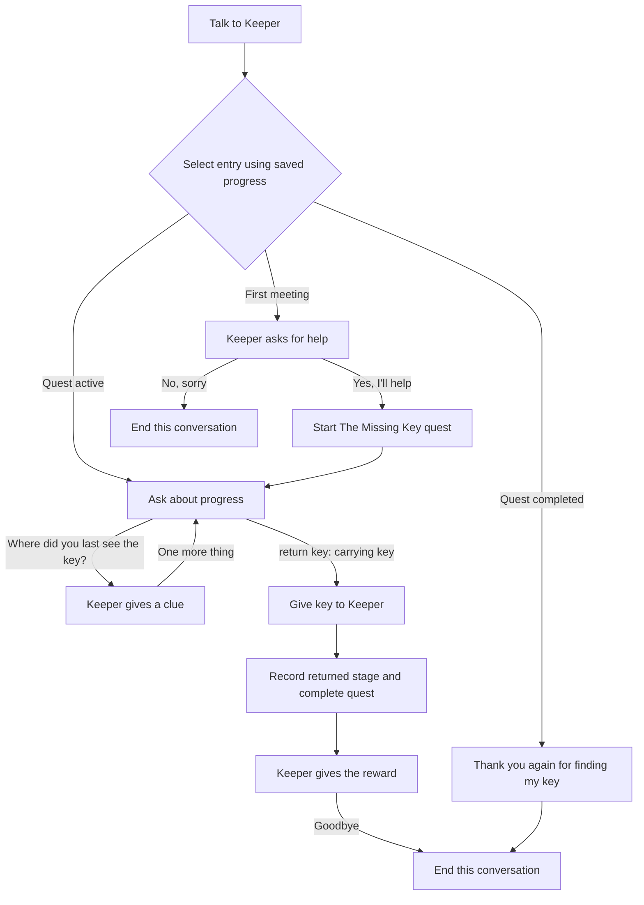

# Conversations and quests

Status: **N0 accepted; N1/N2 complete; N3 next**, refreshed 27 October 2026. The canonical model and persistence foundation are implemented; production quest/conversation execution and authoring remain N3–N5. The owner agreed to basic procedures → conversations/quests → turns/routines and chose designer-written reply choices over free-text matching. Editor UX, containers, parser context, and focused procedures are merged; public guides remain in the later documentation milestone. See the [current TODO list](todo.md) and [procedures plan](block-procedures.md).

Implementation branch: `feature/conversations-and-quests`, created on 26 October 2026 from merged `main` at `040715d`. The agreed reply-model planning changes were carried onto this branch. Keep the model, runtime, format changes, editor, runner, and acceptance example together on that branch until they work end to end. The owner accepted the revised [N0 review guide and interactive preview](../design/conversations-and-quests/README.md) on 26 October 2026 with “perfect that looks much better.” N0 is committed as `4b613a9`. The [shared contract](../design/conversations-and-quests/interaction-contract.md) is now frozen following the [47-scenario N1 Rust proof](../design/conversations-and-quests/runtime-proof-review.md); it takes precedence over earlier proposals below. N1 is committed as `ef05c93`; the owner accepted it and requested N2. The [N2 foundation record](../design/conversations-and-quests/foundation-review.md) now documents implemented models/storage and 322 Rust, 95 frontend, 117 browser and packaged checks. The combined feature still awaits runtime/authoring and final acceptance.

## Updated foundations and review boundary

The merged baseline is focused procedures at `040715d` (PR #4): content formats 1–4 and save formats 1–4, container/private inventory scope, rich messages, session-local clarification/recent references, and typed shared procedure calls are implemented. Use the merged procedure contract. N1 reserved content/save 5 and captured setup 3 without changing its shipped constants; N2 now implements them, preserving the historical examples and explicit legacy paths.

Conversations and quest hooks should use ordinary effects, including shared CALL where useful. Forward typed inputs explicitly, reuse the agreed STOP/ending/rollback rules, and give each node/reply/hook a stable progress root for nested procedure response paths. Plain effect blocks remain sufficient for authors who do not use procedures. Narrative state must not introduce a second parameter evaluator or shared-call cursor scheme.

The following parser/conversation boundaries were reviewed in N0 and proved against the native Session/executor in N1:

- F2 clarification is ephemeral Session context; conversation checkpoints/history are saved story progress. Load clears the former and restores the latter without replaying effects.
- Prewritten conversation choices, world commands, and parser clarification choices need one deterministic priority table. A number must belong to its last offered context and stable identities. Refresh stale lists before accepting a choice; never let a parser number select a conversation reply accidentally.
- A world command can itself need noun clarification during an encounter. Specify which prompt owns subsequent replies, whether the encounter remains active until the world action succeeds, and how cancellation returns to it. Questions/retries/failed requirements must not silently pause or advance a conversation.
- Preserve assisted `cancel` semantics when clarification is enabled and authored `cancel` when disabled. Review explicit `reply <number>`, conversation pause/bye, and reserved-prefix collision upgrades together; do not silently commandeer existing commands.
- Conversation selection uses only the offered reply IDs at the active node. Reply labels have no accepted phrases, keywords, aliases, spelling correction, or fuzzy matching. Conversation replies do not invent a recent-object referent. Ordinary authored world commands retain the F2 reference policy; help/hints retain existing scoped ID resolution.

These are frozen implementation requirements, not yet a production conversation policy. N1 proves the candidate dispatch/transaction; N2 has promoted canonical models/storage; N3/N4 must promote the execution scenarios to public Session regressions. Preserve the accepted N0 presentation and seek feedback for material visible changes.

## Goals and scope

Give characters conversations with context, branching replies, and consequences. A player selects a designer-written response such as “Yes, I'll help,” “No, sorry,” or “Where did you last see the key?” from the current exchange's available choices. A later exchange's replies cannot be selected before reaching it.

Give players a quest log recording discovered goals and completed milestones. Conversations, ordinary actions, and triggers can all update quests. Hints can use quest progress to choose useful clues.

Both features belong to the shared Rust runtime, so editor playtests and exported terminal games behave alike. Reuse Luna's conditions, effects, message formatting, stable references, transactional commands, and persistence.

Agreed reply model and first-release scope:

- Designer-written replies shown as numbered choices in the terminal and accessible selectable controls in the editor playtest. On 26 October 2026, the owner chose “a set of pre written responses” because free-text matching would make the logic prone to bugs. This replaces the earlier proposal for typed phrases/aliases and optional reply lists. Exact control styling and keyboard interaction will be reviewed in the prototype.
- One active conversation at a time, with saved checkpoints and persistent reply history.
- Explicit quest progression through effect blocks. Quest conditions support actions, conversation replies, triggers, and hints; merely reading the log never advances a quest.
- Ordinary single-player text adventures. Natural-language AI, arbitrary scripts, timed replies, repeatable quests, and multiplayer conversations are later work.

## A complete authoring example

The Keeper has lost a key. The player can accept the request, find the key, and return it. The reward reply is offered only at the appropriate exchange and with the required progress.



An ordinary take action records the "Found the key" milestone. The handover reply checks both carrying the key and the quest's progress. It transfers the key, records the return milestone, completes the quest, and gives the reward in one transaction. Repeating the reply cannot award the reward again.

The opening terminal exchange might show:

```text
Keeper says: I have lost my key. Will you help me find it?

1. Yes, I'll help.
2. No, sorry.
```

The player selects `1` or `2`; the editor playtest offers the same two authored choices as selectable controls. These numbers belong to this displayed exchange only.

The player log might show:

```text
The Missing Key — Active
  The Keeper asked me to find a lost key.
  I found the key in the Study.

The Missing Key — Completed
  The Keeper asked me to find a lost key.
  I found the key in the Study.
  I returned the key to the Keeper.
```

Future milestones, their conditions, and the reward are absent from the player's log until revealed by the story.

## Conversation definitions

Use a directed graph with stable node and reply IDs. Branches can merge, and intentional loops can return to earlier topics.

| Definition   | Proposed contents                                                                                                        |
| ------------ | ------------------------------------------------------------------------------------------------------------------------ |
| Conversation | ID, authoring name, character reference, start condition, ordered conditional entry points, default entry node           |
| Node         | ID, authoring name, character's formatted dialogue, entry effect blocks, ordered replies or an explicit terminal setting |
| Reply        | ID, player-facing response text, availability condition, repeat policy, effect blocks, destination node or end           |
| Entry point  | Condition and destination node; first matching entry wins, otherwise use the default                                     |

Dialogue lines support the existing colours and variable/property placeholders. Reuse CHARACTER SAYS's `text::speech` formatter, including the character's current name and configured name colour.

Add condition blocks for whether a node has been visited or a reply has been chosen. Existing variables/properties and new quest conditions can model learned information. Only currently eligible replies are displayed and selectable; a topic that requires discovery has a progress condition controlling when its choice appears.

The ordinary action `talk Keeper` contains START CONVERSATION referencing the conversation. This preserves the existing command vocabulary, aliases, owner scope, and requirements. The editor can offer to create that starter action when the first conversation is added, while preserving existing talk actions. Multiple conversations can belong to one character and be started by different authored actions or conditions.

### Reply selection and progression

1. Derive an ordered list of eligible replies from the active node without running effects. The shared core supplies their stable identities and formatted response text for both hosts.
2. The player selects an offered number or control. Resolve a number through the last displayed list and carry the expected conversation/node/list context with the selected reply ID; do not match typed response text, keywords, or similar spellings.
3. Recheck the expected context, current node, condition, and repeat policy before applying any effects. Future-node, unavailable, and already-used once-only replies cannot be selected even by submitting their IDs directly.
4. Invalid or stale selections leave story state and output unchanged and refresh the available choices with a neutral notice. A changed list never silently gives an old number or control a different meaning. Normal world commands remain subject to the separate interruption rules below.
5. Mark a once-only reply as chosen before its effect blocks run, then follow its authored transition. Nodes and replies can give items, change values, reveal locations, advance quests, or end the game using ordinary effects.
6. Enter the destination node, run its entry effects once for that entry, then print its formatted line and derive the current replies. Re-entering through an intentional graph loop is a new entry; resuming or loading a checkpoint is not.

Entries, reply effects, transitions, messages, quest updates, and resulting triggers share the original command transaction. A runtime error restores the previous node, reply history, world state, quest log, and output. Count all nested work against the existing operation/depth limits.

A terminal destination closes the conversation. A nonterminal node with no eligible replies also closes cleanly after its line, with an authoring/playtest diagnostic where appropriate, rather than trapping the player. Automatic routing chains are outside the initial scope; graph loops require a player reply.

### Commands and interruption

| Input                                                                            | Proposed behaviour                                                                                                                                |
| -------------------------------------------------------------------------------- | ------------------------------------------------------------------------------------------------------------------------------------------------- |
| `talk Keeper`                                                                    | Run the ordinary authored action; its START CONVERSATION effect starts or resumes the referenced conversation                                     |
| `reply 2`                                                                        | Select the second offered reply using its displayed context; invalid selections never fall through to ordinary world actions                      |
| A displayed reply number, such as `2`                                            | Select from the last offered conversation list only when the conversation owns that prompt; parser clarification numbers retain their own context |
| A displayed reply control                                                        | Submit the offered stable reply ID and expected conversation/node/list context, then revalidate eligibility                                       |
| Typed dialogue text, such as `yes` or `ask about key`                            | Does not select a conversation reply; ordinary authored world-command rules still apply                                                           |
| `bye` while conversing                                                           | Pause the exchange at its current checkpoint without awarding completion effects                                                                  |
| `look`, `inventory`, `help`, quest-log commands, `save`, `load`, `saves`, `quit` | Preserve their session-control roles; help and inspection do not replay conversation effects                                                      |
| `hint` / `hint <entity>`                                                         | Retain existing clue progression/autosave rules; refresh any affected reply availability without replaying node entry effects                     |
| Another successfully matched world action                                        | Pause the conversation before running that action, in the same transaction; failed, ambiguous, or unmatched commands leave it active              |

Reserve the reply/quest/quests prefixes in content 5 with the collision checks and prompt precedence in the frozen contract. Make that precedence visible in help and validation. Reply response text is display content and creates no command aliases; existing authored `yes`, `no`, and `ask` actions retain ordinary world-command handling and interruption rules. Keep bare numbers scoped to an active prompt rather than globally reserving them.

Numeric choices refer to the last offered reply list, not a freshly renumbered list that could mean something different. Recheck stale choices and refresh the prompt instead of executing a different reply. Numbered selections and selectable controls must pass through the same core validation. Displaying or restoring choices must not run node-entry effects again.

A reply can select **End conversation** directly. A dialogue node can instead select **After this dialogue → End conversation (terminal)**: run its entry effects, speak its final line, and close without requiring another reply. Terminal dialogue cannot also offer replies; validate that authoring conflict.

**Start & return** makes the default and ordered conditional entries visible. The Keeper’s quest-completed entry targets a separate **On return** node saying “Thank you again for finding my key,” rather than the initial reward exchange. General entry conditions can use quest progress, node/reply history, or ordinary variables/properties; a separate revisit entry does not require a quest.

Default re-entry resumes an unfinished checkpoint. Once the conversation reaches an explicit terminal node, clear its checkpoint; the next talk action selects an entry using current progress. Keep visited-node and chosen-reply history across both cases. Reopening the same active conversation displays context without re-running node entry effects. Switching conversations requires pausing/ending the previous one first; reject unintended nested starts.

If the player or character moves away, the character becomes hidden, or the playthrough ends, stop accepting replies for that encounter. If reply effects remove the speaker before its destination can be entered, keep that destination as a pending checkpoint and enter it once on a later valid resume. An already-entered checkpoint resumes without entry effects. Ending a game closes the active conversation and preserves only historical progress for inspection/save validation.

Define dedicated END CONVERSATION and PAUSE CONVERSATION effects. Closing a conversation is distinct from END GAME and from STOP, which continues to stop only the current effect chain. A reply's normal transition proceeds after STOP unless a conversation-control effect or END GAME superseded it. Check both the active conversation and its encounter generation before following a transition; END/START of the same ID supersedes the old transition too.

### Discovery and puzzle difficulty

All currently eligible replies are displayed as prewritten choices. Authors control topic discovery with node structure and node-history, quest-stage, variable, or property conditions. An unavailable topic is absent from both the offered list and permitted selections; there is no hidden, typeable reply path. Write reply text to reveal only what the player should know at that point, rather than exposing puzzle answers through the choice wording.

Help and reply lists show current permitted information only. Existing Full entity help must not enumerate the whole conversation graph, and Basic help must not reveal later topics. A playtest-only inspection mode may expose the graph and unmet conditions to the author.

## Quest definitions and journal

| Definition | Proposed contents                                                                                                                                              |
| ---------- | -------------------------------------------------------------------------------------------------------------------------------------------------------------- |
| Quest      | ID, title, aliases, introduction, completion/failure messages, stages, and effect hooks for start/completion/failure                                           |
| Stage      | ID, authoring name, player journal text, prerequisite stage IDs, optional world-state condition, required-for-completion flag, and effect blocks when recorded |

Quest status is **undiscovered**, **active**, **completed**, or **failed**. Undiscovered quests are absent from player-facing lists. Starting a quest makes it active and records its introduction. Stages are milestones that can have prerequisites; this supports a simple chain or several objectives completed in either order. Reject prerequisite cycles and references to stages belonging to another quest.

Proposed effect blocks:

- START QUEST: activate an undiscovered quest and record its introduction once.
- COMPLETE QUEST STAGE: require an active quest, satisfied prerequisites, and the stage's condition; record that stage once.
- COMPLETE QUEST: require an active quest and all stages marked required for completion; record completion once.
- FAIL QUEST: fail an active quest and record the failure once.

Mark optional/exclusive-branch milestones as optional, or give successful branches a common required resolution milestone. Completing a required stage does not silently finish the quest; authors place COMPLETE QUEST in the appropriate effect flow or stage hook.

Repeated requests to start, record, complete, or fail an already-processed milestone/status are no-ops. Unmet runtime prerequisites leave progress unchanged and provide an author trace; invalid definitions/references are errors. Completed and failed quests remain terminal in the first release. No automatic restarting or replaying rewards.

Record each transition before its hook runs so re-entrant effects cannot award it twice. Hooks use the same transaction and execution limits as actions/triggers. Quest changes may update variables and fire existing value watches through normal effects. Initial scope uses these explicit hooks; introducing a separate family of global quest/conversation trigger events is later work.

Add QUEST STATUS and QUEST STAGE COMPLETED condition blocks, available in actions, triggers, conversation replies, and hint stages. This allows hints to follow quest progress without making hints and quests the same system. HINT USED retains its existing meaning; reading a quest log never counts as requesting a hint or solution.

The journal stores a per-quest ordered history of recorded entries. Format entry text when the milestone occurs and save the rendered semantic spans, so later variable changes do not rewrite earlier journal entries. Use saved deterministic ordering rather than wall-clock timestamps. Keep stable quest/stage references for validation and editing tools.

Player commands:

- `quests` lists known quests grouped by status, with active quests first.
- `quest <title or alias>` shows the status and recorded history of a known quest. Ambiguous names request clarification; unknown/undiscovered quests do not disclose their definitions.

These commands are read-only, remain available after an ending, and do not fire command triggers or autosave. Avoid reserving generic `log` or `journal` aliases initially. The editor playtest gains a Quest log panel using the same core-produced view as the runner; future player UIs can consume that view too.

## Editor authoring

Add **Conversations** and **Quests** under Game data. Character inspectors link to their conversations, as entity inspectors already link to filtered Triggers.

For Conversations:

- A list supports character filters, search, and creation; a graph canvas shows nodes, reply connections, entry badges, explicit terminal-dialogue markers, and end destinations. Use separate border endpoints for distinct replies, clear arrowheads/direction, obstacle-aware paths and readable nonoverlapping labels; verify reciprocal/loop/merged and dense graphs. Keep selection, node/label positions and viewport stable while editing.
- Use the existing React Flow dependency for the graph. Selecting a node or reply shows its dialogue/response text, conditions, destination, and repeat policy in the inspector. Reply order determines the displayed choice order; preview that list without phrase/alias or matching-mode controls.
- Reuse Blockly for the selected node/reply's condition/effect logic. The graph owns conversation structure; blocks own effect ordering and branching; forms own settings and rich text. All edit one canonical definition.
- Offer "Add reply and new node", link to an existing node, duplicate, arrange, and navigation back to the owning character. Keep selection/zoom/positions stable while editing blocks or text.
- Distinguish unfinished construction drafts from authored graph nodes. Keep temporary drafts and layout in editor metadata; diagnose unreachable authored nodes and invalid executable edges. Resolve the exact draft interaction in the prototype before freezing the editor contract.

For Quests:

- A quest list and stage list show authoring order, prerequisites, and required/optional stages. The selected stage has journal-text fields, conditions, and its effect blocks.
- Provide readable progress previews and shortcuts to usages in conversations/actions/hints.
- The playtest inspector exposes current status, completed stages, active conversation, and checkpoints. Normal player views reveal only information earned during play.

The journal panel, dialogue reply controls, and conversation context should work with collapsed panels and keyboard navigation. Do not automatically apply authoring changes to an in-progress immutable playtest; keep the existing restart-to-apply-edits behaviour.

## Shared model, storage, and compatibility

Canonical additions are project-level `conversations` and `quests` collections, persisted as `conversations/<id>.json` and `quests/<id>.json`. Conversation ownership is a character reference. Keep graph layout, viewport state, notes, temporary drafts, and block workspaces in editor metadata, excluded from bundles.

Extend the shared state with one optional active conversation, per-conversation checkpoints/history, and per-quest status/completed stages/journal history. Checkpoints distinguish Pending from Entered nodes and preserve the entered semantic prompt. Offered reply IDs/tokens remain ephemeral Session context; restore reissues selection authority. A core-produced conversation view supplies the current rendered prompt and permitted replies; restoring/displaying that view does not re-run effects, advance response sequences, or reveal additional hints.

Reserve **content 5/save 5/setup 3** after the merged content 4/save 4/setup 1–2 foundation. The frozen contract specifies legacy/default/rejection paths; N2 implements these versions with canonical storage and compatibility tests. New-format headers must let older engines reject unsupported data before ignoring unfamiliar files or state.

Read all previously supported projects/bundles/saves through explicit compatibility paths, including content/save 1–4. Missing narrative state defaults to no active conversation, no conversation history, and all quests undiscovered; restoration must not infer milestones or replay game-start, node-entry, reward, or quest hooks. Retain existing hint history and all other saved state. Preserve game IDs, authored IDs, and existing content-version matching rules; this is not automatic migration between different released game versions.

Audit new reserved prefixes (`reply`, `quest`, `quests`) before converting legacy content. Existing supported legacy games using those words must retain their old command behaviour. Conversion must report collisions and preserve the source rather than silently renaming/shadowing actions. A format upgrade must be recoverable and use the existing atomic project write/recovery system.

Changes span more than the model structs:

- Extend project loading, managed-file allowlists, revision hashing, recovery journals, Save As, bundle manifests/checksums, import validation, and export's exact file-set checks for the new collections.
- Extend common effect/condition/text/reference visitors to node entry effects, replies, quest hooks, and stage hooks. This includes response-sequence cursor discovery, reset references, message placeholders, validation, reachability analysis, templates, and "used by" tools.
- Add typed references for conversations, nodes, replies, quests, and stages. Copying/duplicating a definition remaps its internal IDs; template insertion requires explicit replacements for references outside the copied content.
- Validate saved references, stage prerequisites/status consistency, once-only reply history, journal ordering/spans, pending checkpoints, and offered replies. Incompatible structural edits preserve the original save and produce a useful compatibility error.
- Generate TypeScript contracts from Rust. Both hosts call the same resolver, conditions, effects, and read-only views; the frontend implements presentation rather than a second conversation/quest engine.

## Implementation milestones on the feature branch

### N0 — Authoring and player design

- [x] Create the feature branch from merged procedures, refresh the content/save-4 baseline, and record prewritten reply choices.
- [x] Build the isolated Keeper graph/reply/quest prototype with the real Luna blocks, contextual source return, construction drafts, numbered/selectable player choices, earned journal, scripted checkpoints and once-only rewards.
- [x] Exercise graph dragging without losing layout on text edits, creation/Undo, keyboard routes, modal focus, compact panels, and both browsers without a project API. Record captures and the review walkthrough separately from production acceptance.
- [x] Address initial owner feedback with distinct routed connections/end badges, editable Start & return entries, a separate terminal acknowledgement after the reward exchange, and browser regressions for connection clearance and repeated visits.
- [x] Owner accepted the revised N0 authoring/player design on 26 October 2026 with “perfect that looks much better,” including the clearer connections and separate terminal/revisit dialogue. Preserve the reviewed graph/block/inspector arrangement, prewritten choices, hidden availability and checkpoint journey; material visible changes return for feedback. Runtime/compatibility acceptance remains N1–N6 work.

### N1 — Runtime proof and frozen contract

- [x] Prove risky semantics against the actual shared Rust Session/executor and merged procedures. The [47-scenario proof](../design/conversations-and-quests/runtime-proof-review.md) and [frozen contract](../design/conversations-and-quests/interaction-contract.md) cover: prompt precedence, stale offer identities, speaker invalidation, entry/pending checkpoints, STOP/END/PAUSE, idempotent quest hooks, historical journal and complete rollback.
- [x] Audit reserved-command collisions, saved-state/captured-setup compatibility, stable hook roots and draft promotion. Freeze the definition/state fields, offer lifetime and content/save 5/setup 3 allocation following N0 feedback and the Rust proof. Preserve historical fixtures; actual new-format storage/process tests remain N2–N6 gates. N1 has 295 passing Rust tests/doctests including 47 candidate regressions, with Clippy/contracts/format checks passing. Do not publish new-format games from the proof.

### N2 — Shared model and persistence

- [x] Add typed definitions/state, IDs and reference/text/script visitors, validation, new managed collections, transactional storage/recovery/export/import, explicit content/save 1–5/setup 1–3 readers/writers, and generated contracts. Keep existing canonical examples/historical saves unchanged and add shared content-5/state/setup-3 fixtures. The [N2 record](../design/conversations-and-quests/foundation-review.md) covers real storage/API/process/package checks and the remaining execution/authoring boundaries.

### N3 — Quest runtime and log

- [ ] Implement explicit effects/conditions, prerequisite and terminal-state checks, once-only hooks, deterministic journal snapshots, reserved read-only commands, core-produced log views and save/load. Use existing CALL/effect/event execution and rollback.

### N4 — Conversation runtime

- [ ] Implement conditional entry selection, offered-list/current-node choice selection, history, guarded transitions, pending/entered checkpoints, interruption, speaker output, and prewritten choice views. Integrate quest effects through the shared executor; prove editor/exported runner parity without a host-side matching engine.

### N5 — Production editor and playtest

- [ ] Add central libraries, character shortcuts, the conversation graph, selected-node/reply blocks and synchronized inspector, full quest/stage authoring, draft promotion/findings, duplication/reference/template/history navigation, accessible choice controls, quest log and debug/source inspection. Get feedback on the real authoring/player slice before final acceptance.

### N6 — Full acceptance and developer notes

- [ ] Author the complete Keeper quest through the editor, save/reopen/export it, and play it in the terminal. Cover named/autosave/process/captured-setup restoration, late-failure rollback, compatibility, Chromium/Firefox, limits/scaling, generated contracts, packaging, and developer notes. Public guides remain deferred to the documentation milestone.
- [ ] Obtain final owner acceptance, commit/push when requested, and merge the complete branch after CI. Start turns/routines from that merged baseline on separate branches.

Each milestone should have focused commits and checks. The existing test suite must continue to pass throughout; do not publish new-format games from a partially implemented milestone. The N0 mockup intentionally does not implement the runtime/persistence responsibilities above.

## Acceptance checklist

- A future-node reply ID, an unavailable current reply, or an already-used reply cannot skip progress or issue a reward. Invalid selections make no story-state changes. Typed dialogue text cannot select a reply or activate hidden conversation topics.
- Numbered selections and playtest controls use the same offered-list/context and eligibility checks. Reserved controls work, parser clarification retains its own prompt context, and stale numbers/controls never select a different reply.
- Accepting/declining a request, branching, merging, loops, terminal nodes, unmatched input, dead ends, interruption, hiding/moving speakers, and game endings behave as specified.
- Saving/loading mid-conversation and resuming a checkpoint never repeats entry effects, sequence replies, journal entries, or rewards. Pending entries run exactly once when validly resumed.
- Quest stages obey prerequisites, parallel objectives work, required/optional stages affect completion correctly, and terminal statuses cannot be accidentally restarted. Duplicate/re-entrant effects produce no extra entries or rewards.
- Unrevealed quests, future stages, unavailable topics, and solutions stay out of help, reply lists, and the journal. Hint conditions can follow quest progress without changing clue-history semantics.
- A failing nested effect rolls back the entire conversation/world/quest transaction and transcript. Operation/depth limits bound recursive hooks and value-trigger chains.
- Renaming preserves references; duplication remaps internal IDs; missing/cross-owner references, reserved-prefix collisions, unreachable nodes, and prerequisite cycles have useful diagnostics.
- Chromium and Firefox cover graph creation, blocks/inspector editing, drafts, save/reopen, panel layouts, and export. The exported fixture has matching editor/runner output, quest history, and named-save continuation.
- Legacy projects, bundles, and saves remain readable without losing existing state. New saves/bundles are rejected clearly by older engines; mismatched or corrupt data is preserved for recovery.

## Decisions to revisit before implementation

The revised N0 design and prewritten choices are accepted. Preserve the reviewed presentation, keyboard routes, terminal/revisit distinction, pause/resume journey and construction drafts. N1 has frozen parser-prompt precedence and runtime/draft compatibility rules. N2 implements the canonical/storage boundary; N3–N6 must complete execution/authoring and acceptance. Material visible changes return for feedback. Free-text response matching is outside this feature's scope. Cross-project conversation libraries, timed dialogue, a global narrative-event trigger family, and repeatable quests are deliberately left for follow-up designs.

Relevant foundations: [current architecture](../architecture.md), [project todo](todo.md), [editor implementation milestones](../../spec/luna-editor-implementation-plan.md), and [runner specification](../../spec/luna-runner-spec.md). This proposal extends those foundations; it does not claim that the existing format or parser already supports these features.
