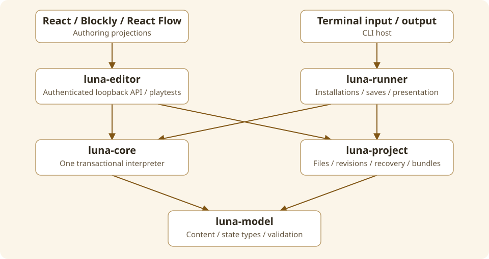

Luna has two hosts and one gameplay implementation. The native editor serves a React/TypeScript authoring UI and hosts playtests. The terminal runner installs exported games and hosts player sessions. Both call the same `luna-core::Session`.

## Dependency direction

| Component    | Depends on                                           | Owns                                                       |
| ------------ | ---------------------------------------------------- | ---------------------------------------------------------- |
| luna-model   | Serde, shared utility/types crates                   | Content/state contracts and validation                     |
| luna-core    | luna-model                                           | Validated definitions, parser, transactions, runtime views |
| luna-project | luna-model                                           | Canonical files, revisions, recovery, bundles              |
| luna-editor  | model, core, project                                 | Local API, project handles, playtests, UI hosting          |
| luna-runner  | model, core, project                                 | CLI, installations, save envelopes, terminal rendering     |
| web          | Generated Rust contracts, React, Blockly, React Flow | Authoring projections, interaction/navigation/history      |

The core has no filesystem, HTTP, terminal or browser responsibility. The model does not depend on hosts. Project storage does not execute gameplay. JavaScript edits canonical content; it does not evaluate the game's effects as a second runtime.

## Trace a player input

1. A host submits text or an offered conversation reply to Session.
2. Session creates one attempted `Run` with a full state copy and buffered output.
3. Control/resolution/matching selects the supported input path. Requirements and effects use the same conditions/executor as triggers and story hooks.
4. The attempt finishes turn/timer processing, routines, conversation preparation and story bounds.
5. On success Session publishes state, interaction context, reply offer and messages together. On runtime error it preserves the previous session and discards ordinary output.
6. The host renders semantic spans and performs requested save/load/quit controls. The runner autosaves committed state changes.

A normal failed requirement is a typed result, not a Rust execution error. An explained attempt uses this same path; it commits when successful. See [execution](/luna-engine/developer/runtime/).

## Four kinds of state

- **Authored content:** immutable during play; identities, descriptions, rules and initial values.
- **Durable player state:** placements, values, visits, progress, earned journal, clock and routine waits.
- **Session-only state:** noun clarification/recent references, reply authority and optional bounded undo history.
- **Editor state:** canvas layout, drafts, templates, setups/checks, findings acknowledgements and personal preferences.

These have different lifetimes and file boundaries. A Blockly block ID may be a library-generated string; canonical entity/flow IDs usually use UUIDs. Do not treat an editor block ID as a game identity.

## Change strategy

Add durable concepts in model/core first, validate and prove native behavior, then expose generated contracts and authoring projections. Keep compatibility explicit before accepting new serialized data. Use typed enums and focused modules rather than inheritance or an untyped event bus.

The detailed [source map](/luna-engine/developer/components/) links every component. Historical design decisions and measurements remain in [repository design records](https://github.com/pmck91/luna-engine/tree/main/docs/design); those records are evidence, not a substitute for current API contracts.
