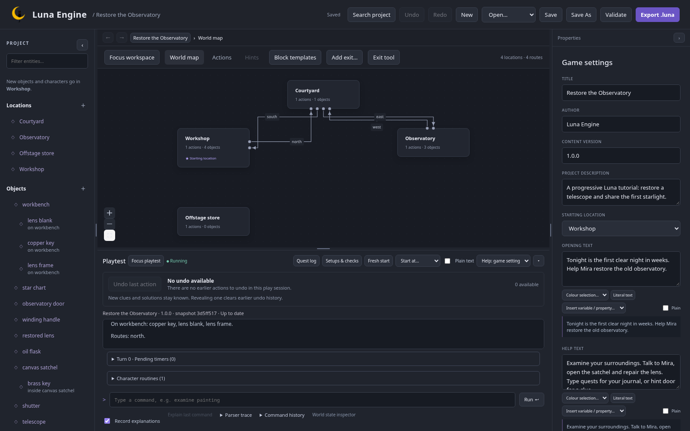

import { Card, CardGrid, LinkCard } from '@astrojs/starlight/components';

Luna is a visual editor and terminal player for **parser-driven text adventures**. Write descriptions, connect rooms and build game logic with blocks. The editor's playtest and the standalone runner use the same Rust engine.

<CardGrid>
  <Card title="Build a living world" icon="star">
    Rooms, movable characters, nested containers and surfaces give your story a
    place to happen.
  </Card>
  <Card title="Write the rules visually" icon="puzzle">
    Connect actions, conditions, responses and triggers. Add conversations,
    quests, timers and routines as your game grows.
  </Card>
  <Card title="Test while you write" icon="magnifier">
    Play beside your blocks, inspect state, explain commands and repeat saved
    checks.
  </Card>
  <Card title="Share a complete game" icon="download">
    Export a .luna file for the terminal runner. Projects and player saves stay
    on your own machine.
  </Card>
</CardGrid>

## Choose your path

<LinkCard
  title="Install and open Luna"
  href="/luna-engine/getting-started/install/"
  description="Start with the Linux package or build from source."
/>
<LinkCard
  title="Restore the Observatory"
  href="/luna-engine/tutorials/observatory/"
  description="Build a complete adventure one feature at a time."
/>
<LinkCard
  title="Designer feature guide"
  href="/luna-engine/reference/feature-map/"
  description="Find a feature, its tutorial chapter and its reference."
/>
<LinkCard
  title="Developer documentation"
  href="/luna-engine/developer/architecture/"
  description="Understand the Rust crates, editor and runner."
/>

The current packaged target is **Linux x86_64**. The editor runs locally in a desktop browser; games run in the terminal. Standalone browser game publishing is a future extension.
