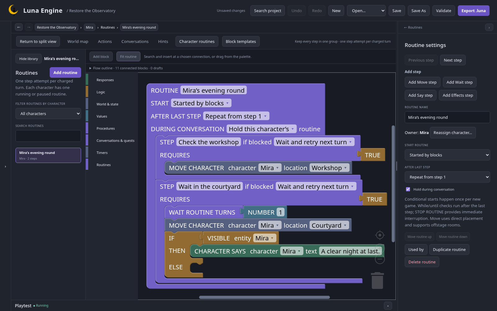

Routines attempt at most one step per character on a charged turn. They need [turns enabled](/luna-engine/logic/time/).

## Create a patrol

1. Add a character with a starting location.
2. Open **Game data → Routines**, or its **Character routines** shortcut.
3. Create a routine and choose its **Owning character**.
4. Connect STEP containers under one ROUTINE root.
5. Put ordinary MOVE CHARACTER and CHARACTER SAYS effects inside steps.
6. Set the root's start policy and **After last step**.

The steps stay together in one Blockly group. Select the root to edit start/repeat/conversation settings, or a step to edit its name, requirement, wait and effects.

## Start and finish deliberately

Start from blocks with START ROUTINE, from the initial playthrough, or once when **START WHEN** becomes eligible. A conditional automatic start is not a continuously restarting action.

After the last step choose finish, loop, **WHILE**, or **UNTIL**. These conditions decide repetition at its boundary. Use explicit START/STOP when you need a new run.

Only one routine controls a character at a time. START uses keep/replace for an already busy owner. PAUSE, RESUME and STOP provide direct control. Saved state retains status and waits.

## Requirements, waits and conversations

A step requirement can retry, skip or pause on failure. A retry waits for a later charged turn; it does not spin through steps. An optional wait retains its remaining charged turns.

**Hold during conversation** prevents the speaker's patrol from advancing during their active encounter. It is separate from a manual pause. Test both.

MOVE CHARACTER is direct placement. A drawn map connection is not pathfinding. Put the door/location guard on a step when the patrol must respect it. Use VISIBLE or location conditions around speech that only nearby players should hear.

Open playtest's routine progress view for current status, next step, blocked requirements and waits. Restore a setup to test that boundary repeatedly.

For a simple four-step patrol and optional labs, open the [Routine Workshop](https://github.com/pmck91/luna-engine/tree/main/examples/routine-workshop).
