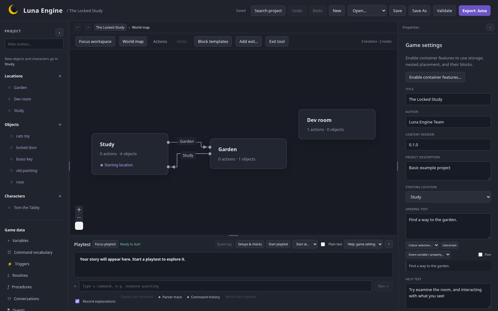

This is the owner's expanded **Locked Study** project, pinned to the source at `150e26f`. It includes Tom, his toy and an offstage room. The small **Start with The Locked Study example** template is an earlier two-room introduction; it does not include all these additions.

Download the [editable project](/luna-engine/downloads/locked-study-project.zip) or [playable export](/luna-engine/downloads/locked-study.luna). Extract the project into your projects directory and open locked-study. Use a copy when experimenting.

The source ZIP includes LICENSE and NOTICE. When sharing the playable export or adapting the example, retain the applicable notices; see [licensing and game credits](/luna-engine/playing/licensing/).

## Read the painting

Start a fresh playtest and enter:

```text
examine painting
examine painting
adjust painting
take key
```

The painting's uneven property selects a changing response. Adjusting it reveals the hidden brass key and sets uneven false. In Actions, select **Adjust the painting** and inspect REVEAL and SET PROPERTY. Repeating adjustment gives a refusal instead of another key.



## Unlock the route

```text
take toy
use key on door
go garden
```

The key action uses two nouns with the literal connector on. Its requirement checks carrying the key. The branch sets door_unlocked, which the Garden exit checks. Inspect both flows to see why opening a door object and making a route traversable are separate authored choices.

You can also inspect the owner's alternative unlock/use-door actions. Their vocabulary phrases differ; use the complete pattern shown by the selected action.

## Help Tom

In Garden, try examine/pet/play interactions suggested by Tom's actions. Then:

```text
give toy to tom
examine rose
```

The handover transfers the toy into Tom's inventory, sets tom_has_toy and moves him to Dev room. That room intentionally has no player route. His toy stays with him.

Examining the rose now reaches **A wonderful afternoon!**. Without returning the toy it reaches **A quiet moment**. Taking the rose reaches **Stolen**. Use separate fresh tests or saved checkpoints to explore those endings.

## Make a small change

Change one of Tom's pet responses, restart and repeat the command to see the loop. Use project Undo to restore your edit. Try the failing play action without the toy and inspect its requirement in a command explanation.

Save before entering Garden, finish, then load from a new runner process. The toy/character position and ending should restore without replaying the handover. The fixed historical regression bundle in .fixtures is a separate older specimen and is not this tutorial download.
