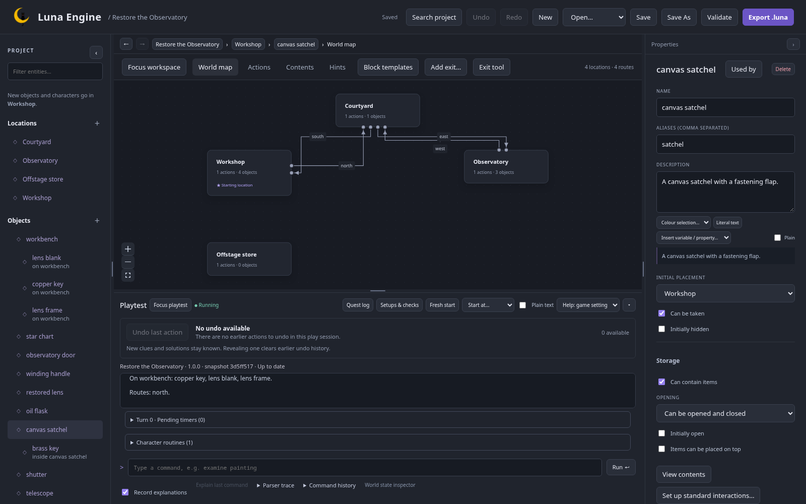

Continue from the world chapter. Add these objects, descriptions and aliases. **Can be taken** enables portability; retain each object's Examine action.

| Object           | Alias     | Initial placement          | Can be taken |
| ---------------- | --------- | -------------------------- | ------------ |
| canvas satchel   | satchel   | Workshop                   | Yes          |
| workbench        | bench     | Workshop                   | No           |
| brass key        | key       | Inside canvas satchel      | Yes          |
| copper key       | key       | On workbench               | Yes          |
| lens blank       | blank     | On workbench               | Yes          |
| lens frame       | frame     | On workbench               | Yes          |
| restored lens    | lens      | Absent                     | Yes          |
| silver token     | token     | Mira inventory             | Yes          |
| star chart       | chart     | Workshop                   | No           |
| oil flask        | oil       | Workshop, initially hidden | Yes          |
| observatory door | door      | Courtyard                  | No           |
| telescope        | telescope | Observatory                | No           |
| winding handle   | handle    | Observatory                | No           |
| shutter          | shutter   | Observatory                | No           |

## Storage and standard actions

For canvas satchel, enable **Can contain items**, choose openable and leave **Initially open** off. For workbench, enable **Items can be placed on top**.

Open **Contents** to assign the keys/components to the appropriate inside/on relationship. The satchel can move with its contents.

Choose **Set up standard interactions**. For the satchel add open, close, look inside, put inside, take from, take and drop. Choose/create the corresponding verbs; use `look in` with synonym `look inside`. For workbench add put on and take from. Review commands before applying.



For the portable components and token, use **Add starter actions** for take/drop if missing. Keep their description actions.

## Craft a lens

In Command vocabulary add `combine`, synonym `fit`. On the lens frame add **Repair lens** with pattern:

```text
combine [lens blank] with [lens frame]
```

Set REQUIRES to ALL(CARRYING lens blank, CARRYING lens frame). In its effect chain connect **COMBINE**, with those two components, both consumption options on and restored lens as result. Follow with SAY: `You fit the lens blank into its frame.`

The result starts absent so it cannot be taken before crafting. COMBINE places it in player inventory. Both inputs become consumed.

## Check this chapter

Restart, `open satchel`, `look in satchel`, `take brass key`. Take blank/frame and combine them. Inspect World state: one restored lens, both inputs consumed.

Try putting the key back in the satchel, taking the satchel and closing it. The player possesses the nested key, but it is not reachable through the closed flap. Undo/restart to restore a convenient state before continuing.

Next: [rules and changing responses](/luna-engine/tutorials/observatory/03-rules/).
