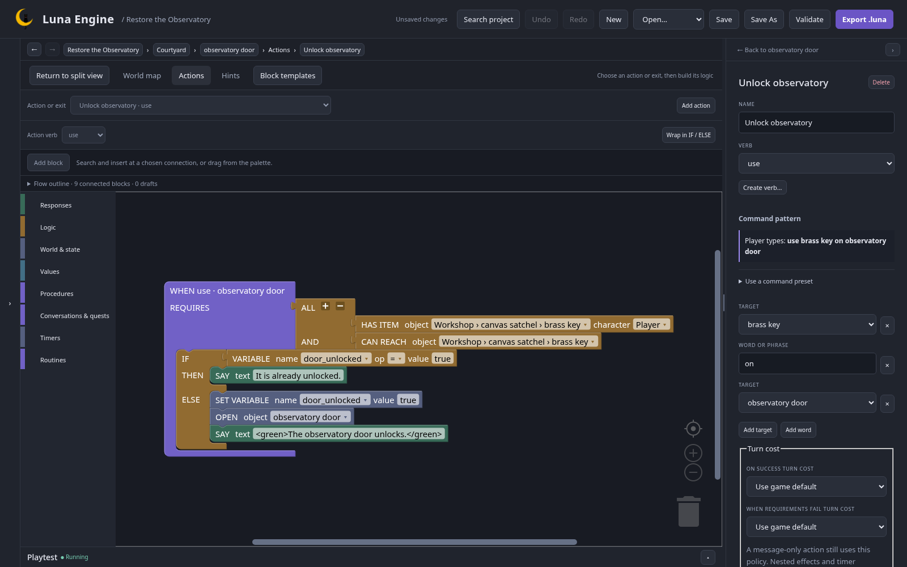

## Define state

In **Game data → Variables**, add:

| Name              | Type    | Initial |
| ----------------- | ------- | ------- |
| score             | Integer | 0       |
| health            | Integer | 3       |
| door_unlocked     | Boolean | false   |
| courtyard_entries | Integer | 0       |
| chart_finished    | Boolean | false   |

On telescope add Boolean property `installed = false`. Keep Mira's calibrated property from chapter 1.

## Require an accessible key

On the door add **Unlock observatory** with verb use and pattern `[brass key] on [observatory door]`.

Set REQUIRES to **ALL** of **HAS ITEM** brass key (player) and **CAN REACH** brass key. This permits a key inside an open carried bag, while a closed bag blocks use. Set a useful failure message.

Connect IF / ELSE checking door_unlocked = true:

```text
IF already unlocked
  SAY "It is already unlocked."
ELSE
  SET VARIABLE door_unlocked = true
  OPEN observatory door
  SAY "<green>The observatory door unlocks.</green>"
```

Select Courtyard's east exit and set Traversable when to door_unlocked = true. Keep Visible when true and blocked text `The observatory door is locked.`



## A changing chart

Replace the chart's Examine effects with RESPONSE SEQUENCE. Replies:

1. `The chart marks the north courtyard.`
2. `A note says: repair, calibrate, install.`

Choose Separate fallback: `You have read every note.` Set follow-up effects once. Connect REVEAL oil flask, SET VARIABLE chart_finished = true, and a message explaining the discovery to AFTER LAST REPLY.

The third examination reveals the oil. Later examinations repeat fallback without repeating its effects.

Add a use-oil action requiring CARRYING oil: CONSUME oil, UPDATE VARIABLE health add 1, SAY a recovery message.

## Triggers

In Triggers create **Count courtyard entries**, owner Courtyard, event Enter. UPDATE VARIABLE courtyard_entries add 1.

Create **Welcome**, owner Game, event Game start, SAY a short workbench introduction.

Before adding the health trigger, open Endings and create **Rest for tonight**, outcome loss, message `Your hands are too tired. The stars will wait for another night.`

Create **Too tired**, watching global health, mode **When the condition becomes true**, condition health <= 0. Connect END GAME to Rest for tonight. Creating the ending now keeps this chapter independently playable.

On handle add `pull handle`: UPDATE VARIABLE health subtract 1, then SAY `The strain costs one health. Health: %health%.`

## Check this chapter

Restart. Before finding the key, the east exit refuses travel. After opening the satchel and taking the key, the unlock command succeeds; repeating it prints “already unlocked.” Re-entering Courtyard increments the counter.

Read the chart three times and inspect the revealed oil. Pull the handle three times in a separate fresh test to verify the loss ending.

Next: [conversation and quest](/luna-engine/tutorials/observatory/04-conversation/).
