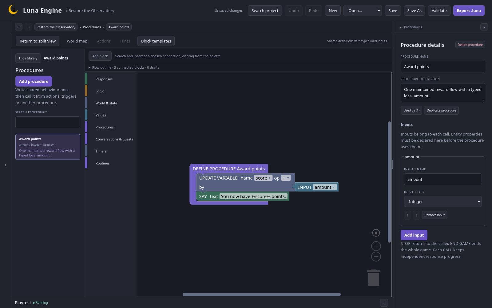
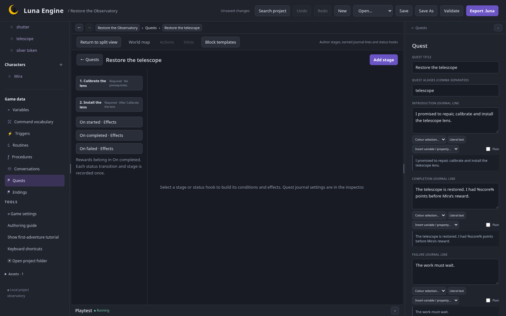
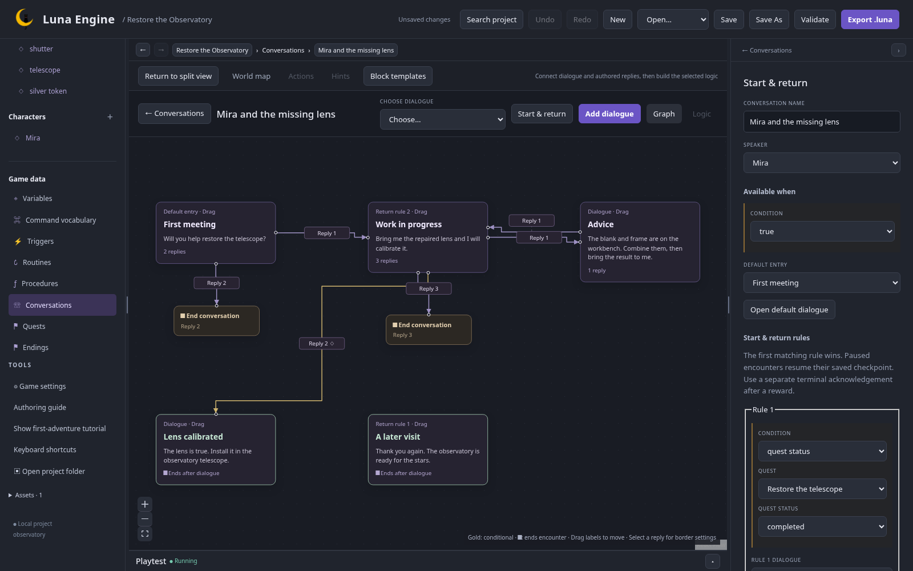

## Share the reward logic

Open **Game data → Procedures**, add **Award points**, then an Integer input `amount`. Connect UPDATE VARIABLE score, add local amount, followed by SAY `You now have %score% points.`

## Define the quest

In Quests add **Restore the telescope**, alias `telescope`. Introduction: `I promised to repair, calibrate and install the telescope lens.`

Add required stages:

| Stage              | Prerequisite       | Condition                                    | Effects                                                   |
| ------------------ | ------------------ | -------------------------------------------- | --------------------------------------------------------- |
| Calibrate the lens | None               | Quest active AND Mira carrying restored lens | SET PROPERTY Mira.calibrated true; ADD ITEM restored lens |
| Install the lens   | Calibrate the lens | telescope.installed = true                   | None                                                      |

Earned lines describe the calibration and installation. Completion line: `The telescope is restored. I had %score% points before Mira’s reward.`

In **On completed**, CALL PROCEDURE Award points with amount 10, then ADD ITEM silver token. Finish the quest once its fields are complete. The next chapter adds the routine start after creating that definition; leave that block out for now so you can test this chapter.

## Draw the conversation

In Conversations add **Mira and the missing lens**, speaker Mira. Create:

| Dialogue         | Text/role                                                            | Replies                                                      |
| ---------------- | -------------------------------------------------------------------- | ------------------------------------------------------------ |
| First meeting    | “Will you help restore the telescope?”                               | Accept → Work in progress; decline → end                     |
| Work in progress | “Bring me the repaired lens and I will calibrate it.”                | Ask advice → Advice; handover → Lens calibrated; leave → end |
| Advice           | Explain blank + frame → combine → return                             | Back → Work in progress                                      |
| Lens calibrated  | Explain installation; terminal                                       | None                                                         |
| A later visit    | “Thank you again. The observatory is ready for the stars.”; terminal | None                                                         |

Accept runs START QUEST. The handover reply requires CARRYING restored lens and NOT Mira.calibrated; enable **Once per playthrough**. Its effects are GIVE TO CHARACTER restored lens → Mira, then COMPLETE QUEST STAGE Calibrate the lens. The stage returns the calibrated lens to the player.

Set default entry First meeting. Under **Start & return**, put quest completed → A later visit before quest active → Work in progress. Add Mira's `talk mira` action with START CONVERSATION.

Use Graph to inspect connections, Logic to edit selected node/reply blocks. Finish every construction draft before playtesting.

## Install and return

On telescope add `use [restored lens] on [telescope]`, requiring CARRYING lens, Mira.calibrated true and quest active. Connect REMOVE ITEM lens, SET PROPERTY telescope.installed true, COMPLETE QUEST STAGE Install the lens, COMPLETE QUEST, then a success message.

Add `give [silver token] to [Mira]`, requiring CARRYING token: GIVE TO CHARACTER token → Mira, then CHARACTER SAYS a thank-you. This demonstrates a repeatable ordinary two-noun action outside conversation.

## Check this chapter

Accept the quest, leave, craft the lens, talk again and select calibration. The handover reply is unavailable before you carry the lens. Install it after unlocking/travelling east: score becomes 10 and the journal completes.

The journal completion line retains the pre-reward score. A later talk uses the terminal acknowledgement and grants no reward. Reply numbers can change with availability; select the offered text.

Next: [time and routines](/luna-engine/tutorials/observatory/05-time/).
