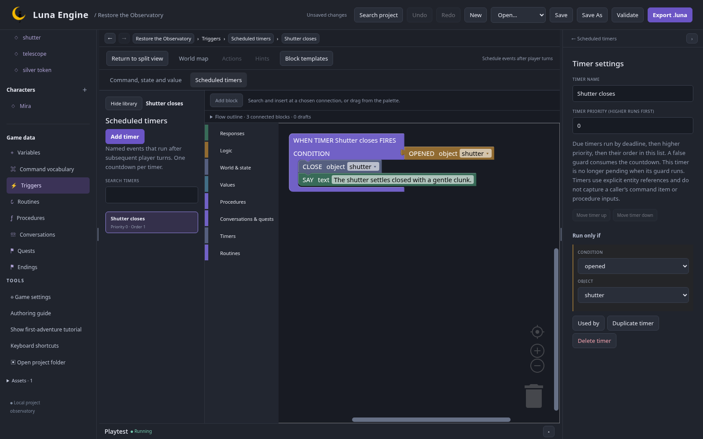

## Turn policy

In Game settings enable turns. Charge successful actions and replies; leave failed requirements, look and hints free. Restart after enabling time.

Set description-only Examine actions free where appropriate. Their state-changing variants still participate in player undo even when free. A turn cost and a state change are different facts.

## Schedule the shutter

Open **Triggers → Scheduled timers**, add **Shutter closes**, condition OPENED shutter. Its effects are CLOSE shutter, then SAY `The shutter settles closed with a gentle clunk.`

On handle add `turn handle`: OPEN shutter, **SCHEDULE** Shutter closes after Number 3 with restart policy, then SAY `The shutter opens. It will close after three more turns.`

Add `push handle`, requiring TIMER PENDING Shutter closes: CANCEL TIMER, then SAY `The catch holds the shutter open.`

After turning, `wait` three times closes it on the third boundary. A free look does not count. Wind it again to retry; this puzzle has no permanent timer failure.

## Connect Mira's routine

Create **Mira’s evening round** in Routines, owner Mira. Start from blocks, loop after the last step, hold during conversation.

Under one ROUTINE root connect:

1. **Check the workshop:** no wait, always allowed, MOVE CHARACTER Mira → Workshop.
2. **Wait in the courtyard:** wait Number 1, always allowed, MOVE CHARACTER Mira → Courtyard; IF VISIBLE Mira, CHARACTER SAYS `A clear night at last.`

Wire the quest completion's START ROUTINE to this definition. It begins only after the telescope is restored. Movement is direct; it does not infer a path from the map.

For an optional experiment, change the start policy to START WHEN quest completed or the repeat policy to WHILE a new Boolean flag. Undo that edit after testing so the finished specimen still matches the walkthrough.

## Check this chapter

After quest completion, inspect routine progress while issuing charged inputs. Mira alternates rooms with the saved wait. Talk to her while the routine runs; conversation hold prevents it advancing until the encounter ends.

Capture a setup after turning the handle. Restore it and confirm the same pending delay and routine wait. Restoring must not spend a turn.

Next: [player assistance and endings](/luna-engine/tutorials/observatory/06-assistance/).
