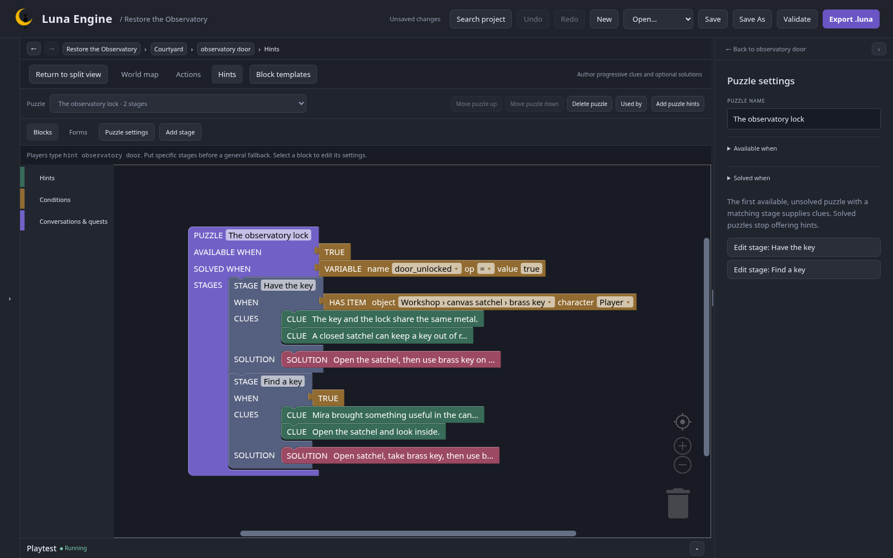

## Keep help useful

Set Entity help **Basic**, Enable puzzle hints on, and edit Help text to describe examination, Mira and the journal. Set Unknown command message to:

> That does not quite fit the night’s work. Try help, or name something you can see.

Enable noun clarification and recent-object references. Both keys have alias `key`: after opening the satchel, `take key` should ask which one. Choose the numbered brass-key option; use `examine it` next. These are exact choices/current references, not fuzzy matching.

## Author the door hint

Select door → Hints. Add **The observatory lock**, available always, solved when door_unlocked = true. Connect these stages in order:

| Stage        | When                       | Clues                                                                                         | Solution                                                  |
| ------------ | -------------------------- | --------------------------------------------------------------------------------------------- | --------------------------------------------------------- |
| Have the key | HAS ITEM brass key, player | “The key and the lock share the same metal.”; “A closed satchel can keep a key out of reach.” | Open the satchel, then use brass key on door.             |
| Find a key   | Always                     | “Mira brought something useful in the canvas satchel.”; “Open the satchel and look inside.”   | Open satchel, take brass key, then use brass key on door. |

Specific stages come first. A final solution is shown only on explicit request.

## Offer undo

Enable **Allow player undo** under Player assistance, reviewing any upgrade/collision notice. Try taking a key then Undo last action. Free state-changing actions also qualify.

Newly revealed hints remain known and clear earlier undo history. Save/load/restart clears history; ordinary Save does not. Do not confuse this with project Undo.

## Create endings

In Endings add:

- **First light**, No outcome: stars return, with score placeholder.
- **A little guidance**, victory: acknowledge reaching the stars with help.
- **Rest for tonight**, loss: retain the ending you created for the health trigger in chapter 3.

Connect Too tired's value trigger to Rest for tonight.

On telescope add `use telescope`, requiring telescope.installed true AND OPENED shutter. IF HINT USED The observatory lock → END GAME A little guidance; ELSE → END GAME First light.

The chart's optional oil can recover health; pulling the handle three times from full health reaches the loss ending. Its value trigger checks <= 0.

## Check this chapter

Use fresh sessions to test hinted and unhinted wins, then a health loss. Undo a same-session ending when history is available. Save/load a completed game: it stays completed and shows its ending without replaying rewards.

Next: [test and share](/luna-engine/tutorials/observatory/07-testing/).
