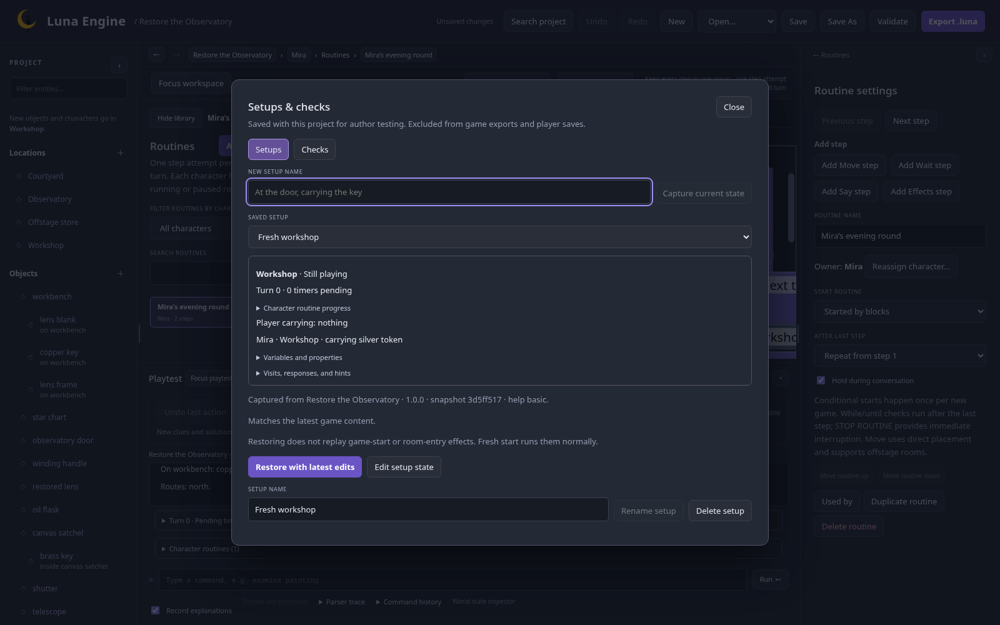

## Review the project

Search for `lens`, open its actions/messages and inspect **Used by**. Check the unlock action's failure path and the quest's completion reward.

Save an action or effect chain in **Block templates**. Insert a copy into a disposable action, choose replacements, then use project Undo to remove it. The template library remains project-local; a procedure is the right choice for maintained shared reward behavior.

Use Back/breadcrumbs to return to an entity, collapse/reopen Inspector and Playtest, then Focus workspace / Return to split view. Your game session should survive layout changes.

## Handle intentional warnings

Validate. The two key aliases deliberately overlap to demonstrate clarification. Offstage store is intentionally unreachable. Acknowledge those specific warnings; record a reason such as `Intentional offstage staging room; no player route.`

Keep other warnings visible. An acknowledgement is editor metadata, not a world rule. Blocking errors still need repair.

## Save checkpoints and checks

In Playtest tools capture setups named **Ready for calibration**, **Ready to open shutter** and **Shutter countdown** at those moments. The downloadable project includes native captures.

Create a saved check for the [complete route](/luna-engine/tutorials/observatory/#complete-player-route), expecting First light and score 10. Add a countdown check starting from Shutter countdown, with three waits and an expected closed shutter.



Run checks after related edits. Record an explanation for a failed unlock and follow its source link. It executes the attempt; an explanation is not a dry run.

## Assets

The example registers **field-notes.txt** under Assets. This demonstrates packaging a file. Assets do not automatically create images, sound or readable in-game commands. The current runner presents text.

## Export and test the runner

Save, validate and Export. Import the bundle with the runner, then use the complete route. Save before the final telescope action:

```text
save before stars
use telescope
save completed
quit
```

Open a new process with `--load "before stars"`, finish again, then load completed. The same score, quest progress, clock and ending should return without duplicated rewards. Save history is distinct from session-local player undo.

The editable-project download includes layouts, setups/checks and acknowledgements. The .luna download includes only runtime content/registered assets.

## Keep the example reproducible

The [feature map](/luna-engine/reference/feature-map/) links every system to a chapter. The source digest and capture record in [evidence.json](https://github.com/pmck91/luna-engine/blob/main/docs/site/evidence.json) let maintainers check when screenshots/downloads need refreshing.

After this game, use the focused workshop examples for deeper edge cases. You can build a much larger game without adding every advanced system to every puzzle.
