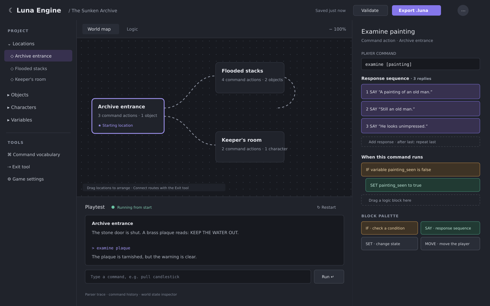
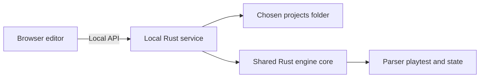

# Luna Engine Web Editor Specification

**Status:** Product and interaction specification for the first editor release  
**Product:** Luna Engine, a Rust-based text adventure engine and visual authoring tool



*The mockup illustrates the intended workspace. It is a design reference, not a final pixel-perfect requirement.*

## 1. Purpose

The Luna Engine editor lets an author create, organize, validate, and playtest parser-driven text adventure games without writing code. Authors build a world from locations, objects, characters, verbs, triggers, and exits. They describe behavior with drag-and-drop logic blocks. Players interact with the resulting games by typing commands.

The editor is a web UI served locally by a small Rust service. The service manages local project files and uses the same Rust engine core as the game runtime for parser-aware playtesting.



## 2. Product principles

- **Typed commands are the player interface.** The editor’s map and block UI are authoring tools; they do not create player-facing choice menus.
- **Visual authoring first.** The map, hierarchy, inspector, and logic blocks should make the game understandable without requiring authors to edit source files.
- **Readable, portable projects.** The canonical project is a normal directory of readable files suitable for Git.
- **Predictable behavior.** Command resolution and trigger execution are deterministic, and likely conflicts are reported by validation.
- **Local ownership.** Projects live on the user’s system. There are no accounts, cloud sync, or collaborative editing in the first release.

## 3. Workspace and UI

The desktop workspace has four main areas:

1. **Project hierarchy:** locations, objects, characters, variables, command vocabulary, and game settings. Supports search and selecting an item for editing.
2. **World map canvas:** draggable location nodes and visible routes. Authors can add locations and connect them with the Exit tool. Canvas supports pan and zoom.
3. **Inspector and block editor:** properties and command patterns for the selected item, with a Scratch-like palette of conditions and actions. Blocks can be dragged into an ordered action flow and reordered.
4. **Command playtest:** an embedded parser-driven game transcript and command input, with restart, command history, parser trace, and world-state inspection.

The UI uses a Unity-style hierarchy, canvas, and inspector layout. There are **no custom keyboard shortcuts** in the first release. Controls should remain keyboard reachable through standard browser navigation; drag-and-drop is the primary editing interaction.

## 4. Game content authors can create

### Project

Project title, description, author, starting location, opening text, help text, format version, endings, and game-wide triggers/settings.

An ending has a stable ID, player-facing text, and an outcome such as victory, loss, or neutral. An `END GAME` block selects an ending and stops further actions. Authors can mark a game as requiring a reachable ending; validation then checks that at least one ending can be reached from the start.

### Locations

Each location has a stable ID, name, player-facing description, verbs/actions, objects or characters present, entry/leave triggers, and exits. A location supports separate first-entry and later-entry behavior.

The engine tracks a visit count for each location. `On first entry` fires once per new playthrough; `On every entry` fires each time. Visit state is part of the game state and is preserved when the engine saves a game.

### Objects

Objects have a stable ID, display name, aliases, description, location or inventory presence, attached verbs, triggers, and mutable state. Objects can be taken, dropped, consumed, moved, revealed, hidden, opened, closed, or otherwise changed through authored actions.

Authors can define combinations such as using one object on another. An action specifies whether to keep or consume each input object and which result object to create. The editor validates references to all source and result objects.

### Characters

Characters have a stable ID, name, aliases, description, location, attached verbs, dialogue/action triggers, and mutable state.

### Variables

Variables are named, typed game-state values referenced by conditions and effects. The editor provides a variable list, value inspection in playtest, and validation for missing or incompatible references.

## 5. Command vocabulary and parser authoring

Each project has a **global command vocabulary**. A verb has one canonical form and any number of synonyms, for example `examine` with `inspect` and `look at`. Authors choose which verbs apply to a location, object, or character, then define the command pattern and behavior for that target.

Command patterns support direct objects and prepositions, such as:

- `pull [candlestick]`
- `use [brass key] on [stone door]`
- `go [east]`
- `follow [less traveled trail]`

Objects and locations may also have aliases so multiword names can be recognized. The parser normalizes case, repeated whitespace, and ordinary punctuation before matching. The runtime may suggest a close vocabulary match for a misspelling, but must never silently rewrite or execute the player's command.

### Deterministic matching

When more than one action may match a command, use this order:

1. Prefer the most specific command pattern.
2. Prefer the narrower scope: object/character action, then location action, then game-wide action.
3. Use explicit author priority to break remaining ties.
4. If a tie remains, ask the player to clarify and perform no action side effects.

The editor warns about overlapping patterns or triggers and links the warning to the relevant actions. The warning does not make the project uneditable; the author can adjust patterns, conditions, or priority.

Exact built-in commands such as `look`, `inventory`, `help`, movement, and save/load are defined in the engine/runner specification. The editor must show reserved commands and prevent a project command from silently shadowing them.

## 6. Triggers, conditions, and logic blocks

Triggers can be attached to the game, a location, an object, or a character. The first release supports:

- Game start and game ending.
- Entering and leaving a location.
- A matched player command.
- Examining, taking, dropping, pulling, pushing, turning, opening, or closing an object.
- Using one object on another.
- Speaking to or interacting with a character.

An object trigger can reveal a route, change a variable, alter another object, display text, or move the player. For example, `pull candlestick` can set `secret_door_revealed` to `true`; the secret exit then becomes visible.

Each action is authored as an ordered flow:

1. The player command or event matches.
2. Optional `IF` / `ELSE` conditions check game state.
3. Ordered effects run, such as `SAY`, `SET`, `ADD ITEM`, `REMOVE ITEM`, `CONSUME`, `COMBINE`, `MOVE PLAYER`, or `END GAME`.
4. An optional `STOP` ends the current action flow.

Failed requirements have an explicit response or alternate branch. Effects are not run when the action’s conditions fail. The editor’s block palette uses typed fields and references; authors do not write arbitrary code or regular expressions.

Overlapping matching actions are diagnosed in the editor. Execution order is stable and follows the matching rules above, then explicit priority. Runtime event dispatch must guard against runaway trigger chains, and validation should report obvious cycles such as locations that repeatedly move the player between each other on entry.

## 7. Exits and movement

The **Exit tool** creates a route from one location to another. Authors connect locations on the map, then set:

- Command verb/patterns and aliases, including named routes or directions.
- Destination and whether the route is one-way or has a reverse route.
- Conditions for visibility and for traversal.
- Optional text and state effects when the route is used.

Visibility and availability are separate. A hidden door can become visible after an object trigger, then remain locked until another condition is met. Routes are displayed on the author’s map, not as mandatory player choice menus.

The `MOVE PLAYER` effect remains available for traps, falls, portals, and other movement that is not a normal traversable exit.

## 8. Repeated response sequences

An interaction can contain an ordered response sequence with no small fixed authoring limit. Each successful invocation emits exactly one `SAY` response, then advances that sequence’s cursor. It must not print all queued responses at once.

Authors can add, remove, and reorder responses. After the last response, the default behavior is to repeat the final line. The author may instead choose to loop to the first line or show a separate fallback response. Each sequence has its own cursor; cursors are part of runtime state and are preserved by game saves.

Example for `examine [painting]`:

1. “A painting of an old man.”
2. “Still an old man.”
3. “He looks unimpressed.”

## 9. Playtest, debugging, and validation

The editor playtest runs the same Rust engine core used by the game runtime. It accepts typed commands and shows the actual parser response; it is not a JavaScript approximation of game rules.

Playtest tools include:

- Restart from the beginning or start at a selected location.
- View command history and a parser trace explaining which pattern matched.
- Inspect current location, inventory, variables, object states, visit counts, and response-sequence positions.
- Set up a test state to reach a puzzle or ending quickly.
- Test first visits, repeat visits, object interactions, combinations, exits, and endings.

Validation reports errors and warnings with links to the affected content. Checks include missing IDs/references, invalid starting location, unreachable locations, unreachable endings when the project requires one, exit destinations that do not exist, impossible or duplicate command matches, overlapping triggers, invalid object-combination results, and trigger cycles that can repeatedly move the player or re-fire.

## 10. Local projects and file handling

A small Rust service runs on the user’s system, serves the editor UI, handles filesystem operations, and exposes the Rust engine core to the playtest. It binds to the local machine by default and can read/write only within the user-selected projects location.

The first-run flow lets the author choose or configure a projects directory. The editor supports New Project, Open Project, Save, Save As, and opening a project folder. Save writes ordinary project files into that folder. Autosave and crash recovery are included; they do not provide cloud storage or editor-managed version history.

Because Git is user-managed, the editor should detect when project files change externally and warn before overwriting stale in-memory content. It should offer a way to reload or compare before saving over those changes.

### Canonical project structure

The editable game is a directory of pretty-printed JSON files with stable IDs and references. Entity names can change without breaking references. Output ordering should be stable to keep Git diffs useful.

```text
sunken-archive/
  game.json
  vocabulary.json
  locations/
    archive-entrance.json
    flooded-stacks.json
  objects/
    brass-key.json
    candlestick.json
  characters/
    keeper.json
  assets/
  editor/
    map-layout.json
```

`game.json` records project metadata and the game-format version. `vocabulary.json` stores shared verbs and synonyms. Entity files store their own authored content, triggers, actions, and references. `editor/` stores UI-only information such as map positions. Assets use relative paths inside the project.

### `.luna` bundle export

The editor exports a **standard ZIP archive** with the `.luna` extension. The bundle contains the game definition, vocabulary, entity files, required assets, and version metadata. It excludes editor recovery/cache data and player save files. Exporting does not alter the editable project folder.

How the engine imports or runs `.luna` bundles is specified in the separate runner/engine spec.

## 11. Saves and engine boundary

The editor owns project saving. It does **not** choose where player game saves are stored. The main Rust engine executable owns save-file locations and the player-facing save/load workflow; those details belong in the runner/engine specification.

The runtime save model must preserve the complete mutable world state, including current location, inventory, variables, object existence/location/state, location visit state, consumed/combined object outcomes, ending state, and response-sequence cursors. Saves refer to stable entity IDs and identify the game version they were created from.

## 12. First-release exclusions

- Cloud sync, accounts, collaboration, and shared editing.
- Custom editor keyboard shortcuts.
- Arbitrary user scripts, regular-expression authoring, or an AI command interpreter.
- Defining player save paths or the import workflow for `.luna` bundles; these belong in the engine/runner spec.

## 13. Acceptance criteria

The first release is ready when an author can:

1. Create and save a project in a chosen local projects directory.
2. Add locations, objects, characters, variables, verbs, synonyms, triggers, and exits using the visual editor.
3. Connect locations visually and define typed commands that traverse or alter the world.
4. Build conditional actions from drag-and-drop blocks, including object consumption and combinations.
5. Add an unbounded response sequence and verify that each repeated command displays one response at a time.
6. Playtest using the real Rust engine core, inspect parser matches and world state, and validate conflicts and broken references.
7. Export a `.luna` ZIP containing the game files and referenced assets while leaving the project folder intact.
8. Use Git externally without the editor silently overwriting changes made on disk.

## 14. Deferred to the runner/engine specification

- Built-in command list and reserved-command behavior.
- Player save-file location, format, save slots, and load workflow.
- `.luna` import behavior and whether the engine runs a bundle directly or extracts it.
- Engine launch options and player-facing runtime experience.
